<div align="center">


# Spatial Map — open-source indoor mapping software

**English** · [Español](docs/i18n/README.es.md) · [Français](docs/i18n/README.fr.md) · [Deutsch](docs/i18n/README.de.md) · [中文](docs/i18n/README.zh-CN.md) · [العربية](docs/i18n/README.ar.md)

**Turn CAD, DWG and PDF floor plans into live 3D indoor maps and digital twins.**
Map warehouses, hospitals, malls, factories and campuses floor by floor, then
connect live data from RTLS, RFID, BLE and IoT sensors, your WMS or ERP, or any
table, webhook or API, and watch it on the map with heatmaps, alerts,
turn-by-turn wayfinding, dashboards and reports. Self-hosted with Docker. MIT.

[](https://github.com/Siraj-zaki/spatial-map/actions/workflows/ci.yml)
[](https://github.com/Siraj-zaki/spatial-map/releases)
[](LICENSE)
[](https://github.com/Siraj-zaki?tab=packages&repo_name=spatial-map)

[**Documentation**](https://spatialmap.io/docs) ·
[**Cloud version**](https://spatialmap.io) ·
[Quick start](#quick-start) ·
[Features](#features) ·
[Releases](https://github.com/Siraj-zaki/spatial-map/releases) ·
[Contributing](CONTRIBUTING.md)

<a href="docs/media/spatial-map-overview.mp4">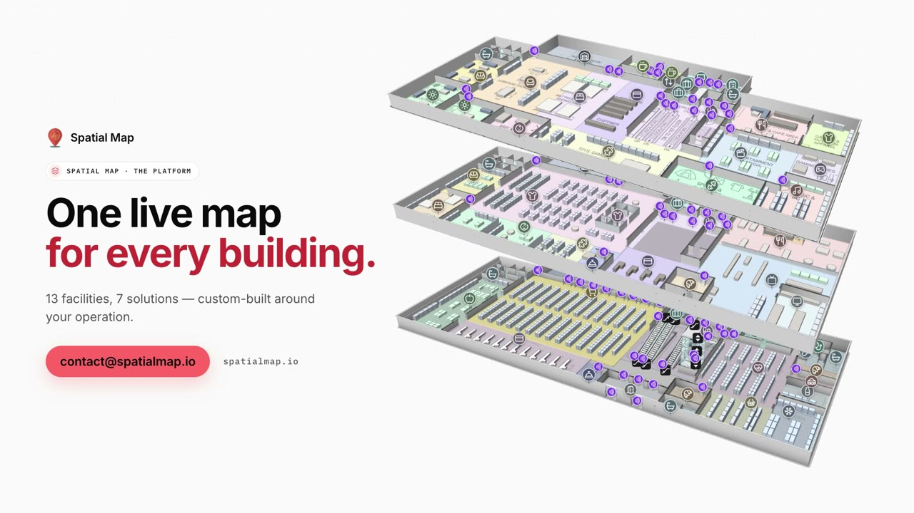</a>

▶ [**Watch the 90-second overview**](docs/media/spatial-map-overview.mp4)

</div>

---

## Showcase

One app for every kind of building. Each of these is a facility built in Spatial Map: floors drawn over the
real floor plan, live data on top.

| | |
|---|---|
| 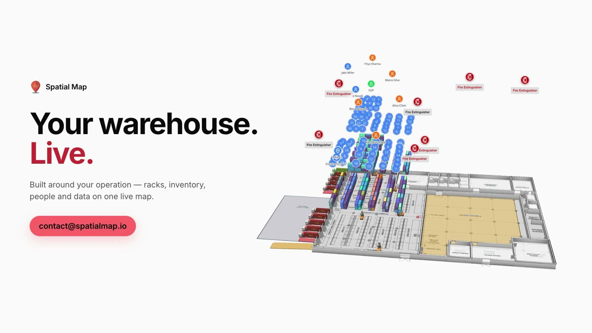 **Warehouses** — racks, inventory, people and safety | 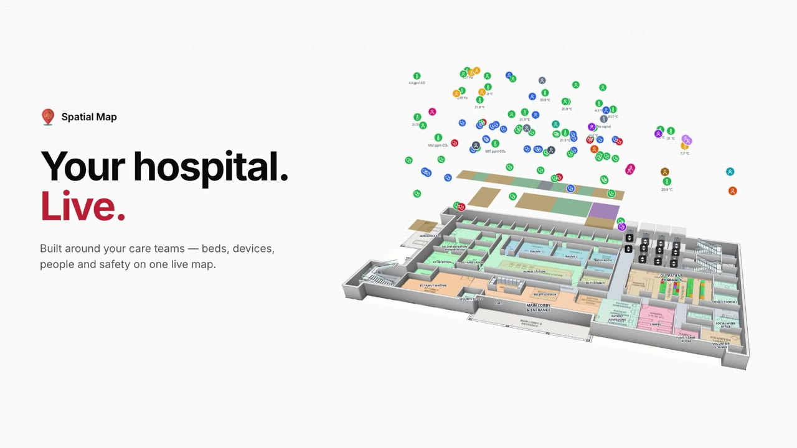 **Hospitals** — beds, devices, staff and safety |
| 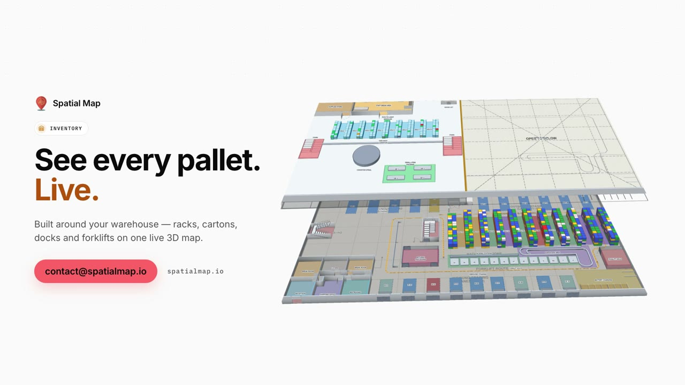 **Inventory** — every rack, carton, dock and forklift | 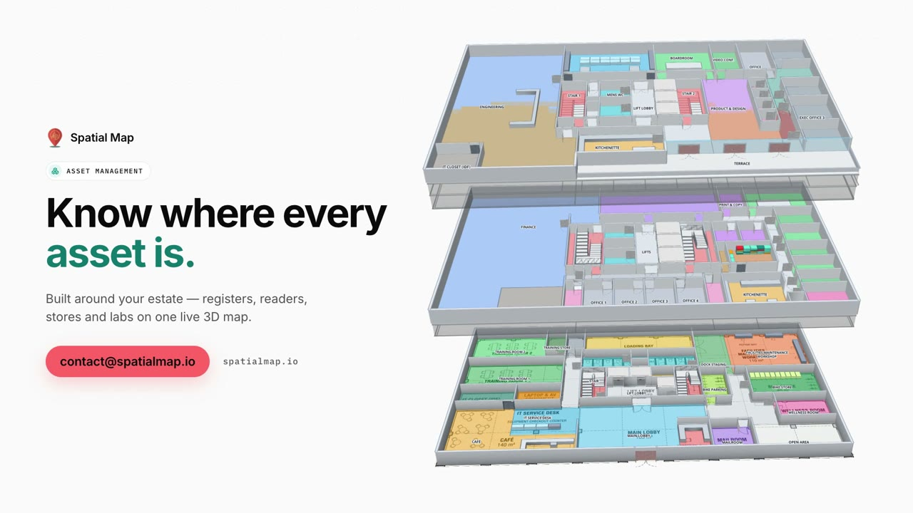 **Asset management** — tags, readers and assets across floors |
| 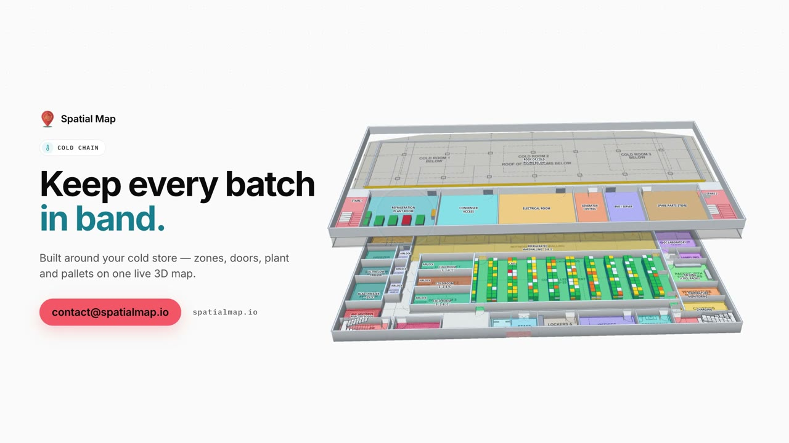 **Cold chain** — zones, doors and temperature alerts | 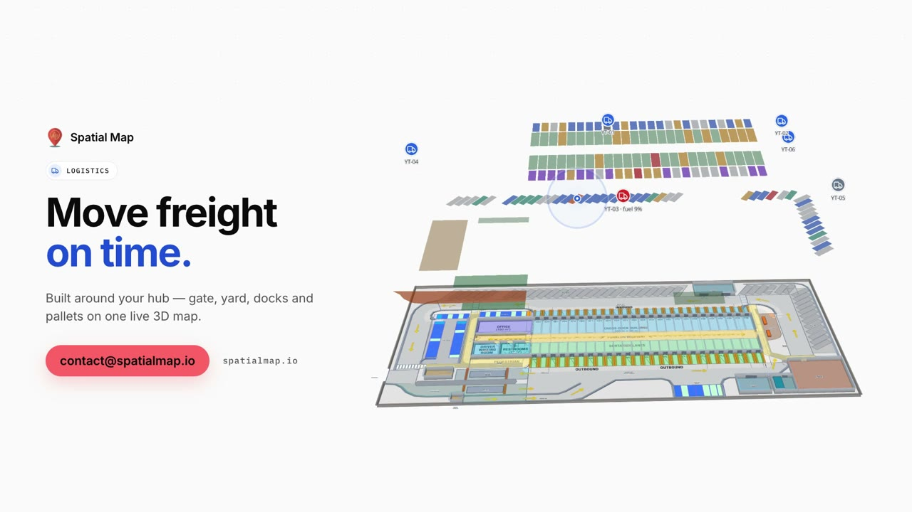 **Logistics** — gates, yard, docks and pallets |
| 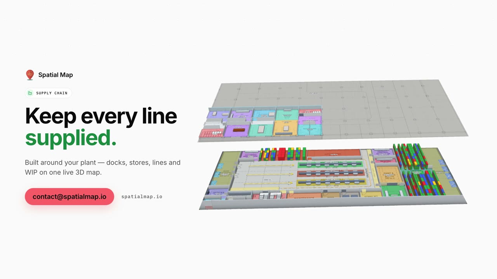 **Manufacturing and supply chain** — docks, stores, lines and WIP | 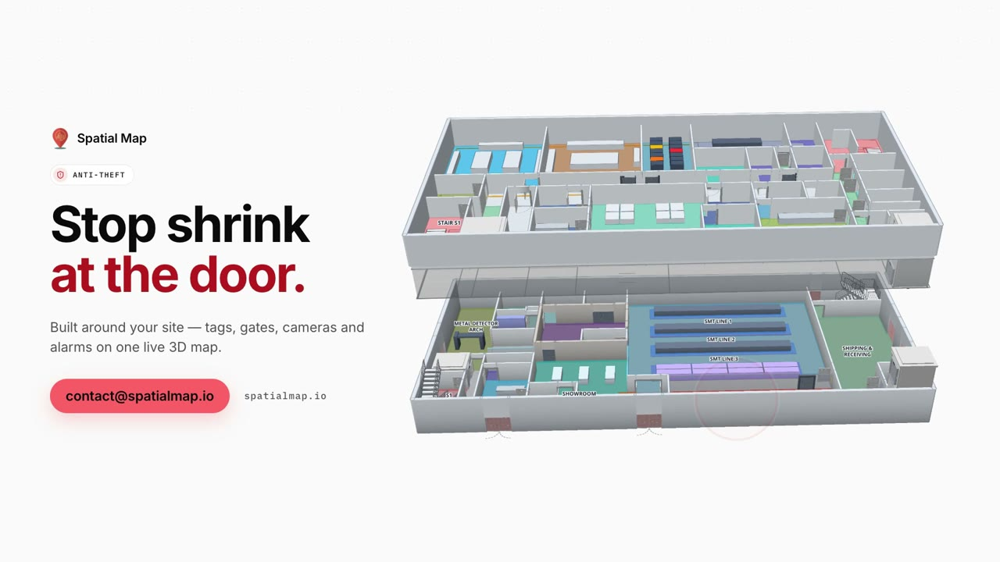 **Anti-theft** — RFID tags, gates, cameras and alarms |
| 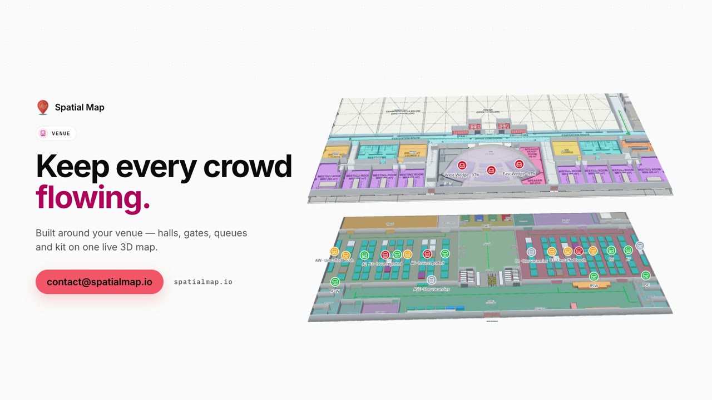 **Venues and stadiums** — halls, gates, queues and kit | 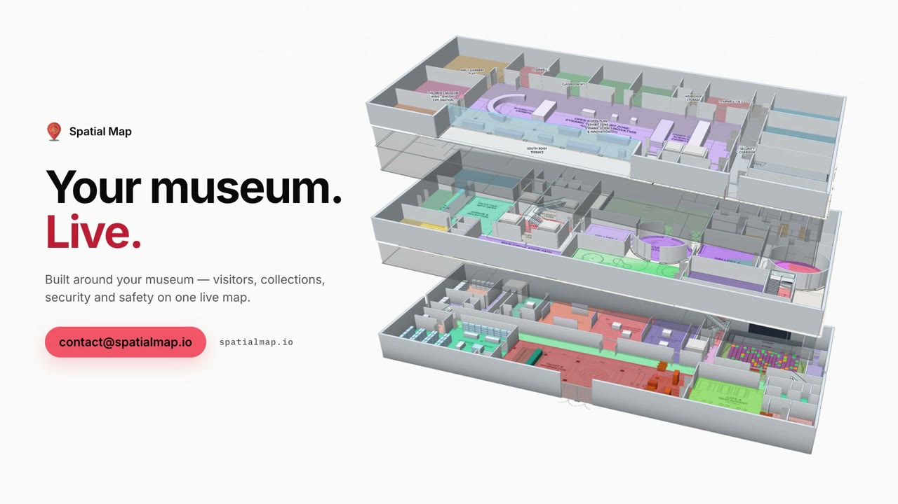 **Museums** — visitors, collections and security |
| 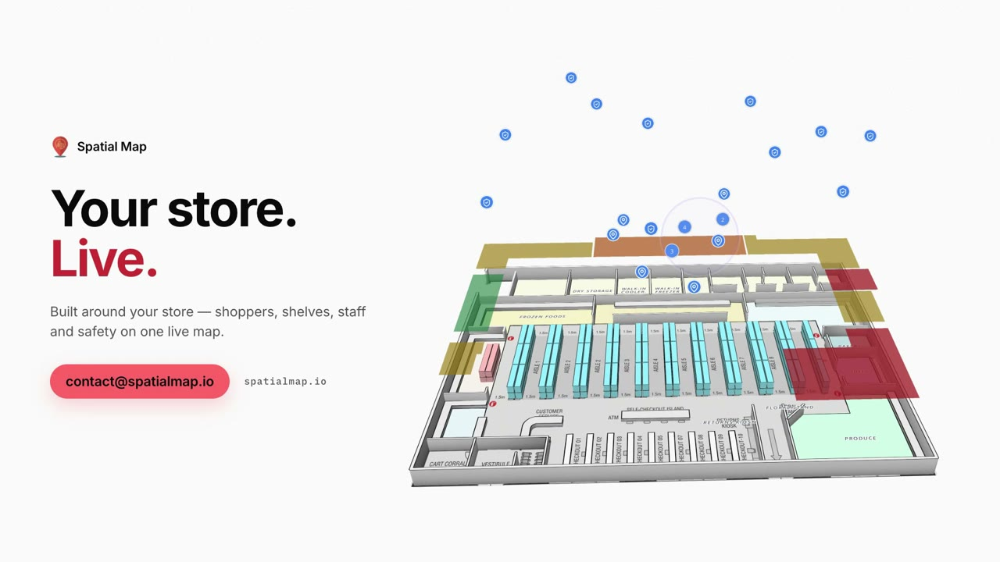 **Retail and supermarkets** — shoppers, shelves and staff | 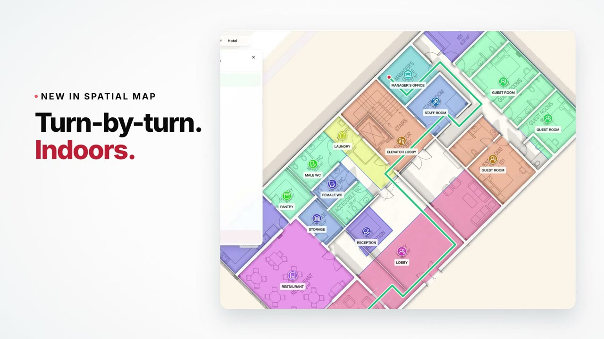 **Indoor navigation** — turn by turn, across floors |

---

## Features

### From floor plan to live indoor map

| | |
|---|---|
|  | **Import any floor plan**: PDF, DWG (AutoCAD) or an image, placed on a real map and scaled with a **calibration** tool (measure a known length). Draw walls that **join cleanly at corners**, leaning walls, areas, doors, stairs, lifts and escalators, **racks with bins** (straight or **bent along a path**), markers, labels and 3D models. A **Measure** tool (`U`) with live dimensions, **typed lengths** for every point (`3.5`, `350cm`, `12'6`) and an angle lock make it CAD-precise. |
|  | **Multi-floor buildings in 3D**: every floor stacked at its real height, with per-floor reference views, a blank sheet for floors without a drawing, bulk editing in every saved-shapes list, undo/redo, keyboard shortcuts, and **export** to GeoJSON, CSV, XLSX and **3D `.glb`**. |
|  | **Live 3D viewer and digital twin**: every floor, rack, bin, area and 3D model on a real Mapbox map, with live data coloured and labelled by your own rules. **Focus mode** fades only what is in the way of the item you click. Share read-only links with chosen floors, layers and filters. |

### Live data: RTLS, RFID, BLE, IoT, WMS and ERP

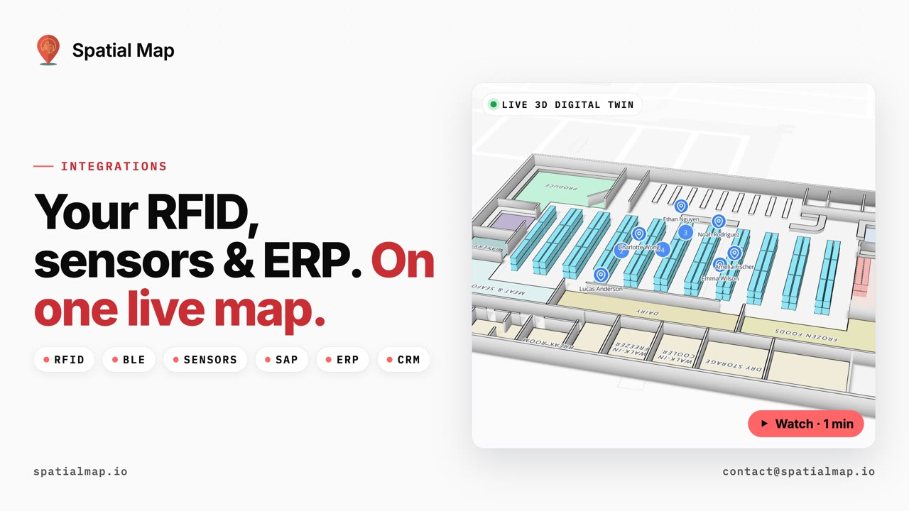

| | |
|---|---|
|  | **Data links**: bind rows from tables, REST APIs, webhooks, files or live WebSocket streams to shapes by name, code or coordinates. Positions from an RTLS, RFID reads, BLE tags, sensor values and WMS / ERP records all arrive the same way. **History playback** with a time range replays any moment. |
|  | **Alerts** (new in 0.3.0): rules over any table (a condition, held for a duration, a stale value, or a count), checked on the server every 15 s, pinned to the spot on the map, with a bell and a chime. |
|  | **Reports and dashboards**: a report builder with KPIs, charts, tables and viewer filters, a **master report** per facility, ready-made reports for every facility and table, full-map layouts, **heatmaps** that stop at walls, **point clustering**, and **public links to a single report**. |

### Wayfinding

| | |
|---|---|
|  | **Turn-by-turn indoor navigation**: routes follow the building's axes, pass through door centres and go **across floors** by stairs and lifts, with step-by-step directions. **Place search** finds addresses, coordinates and Google Maps / OpenStreetMap links. |

### And also

- **Workspaces, members and custom roles**: four built-in roles plus your own
  permission sets; admins can create accounts directly; viewers are read-only
  on the API, not just in the UI.
- **Tables** with CSV/XLSX import, a REST API and bearer tokens per table,
  polling sources and row history.
- **Solutions** group facilities, reports and data (e.g. "Anti-theft").
- **Six languages** (English, Spanish, French, German, Chinese, Arabic with RTL),
  light/dark themes and 46 colour palettes.
- An optional **AI floor-plan tool** that detects rooms and walls.
- **Self-hosted means everything is unlocked**: no plans, no limits, no telemetry.

> **Prefer not to host it yourself?** [spatialmap.io](https://spatialmap.io) is
> the managed cloud version of Spatial Map.

### What's new

| Version | Highlights |
|---|---|
| **0.3.0** | Alerts, custom roles, admins create accounts, a complete "Duplicate facility", welcome tour, sign-up guard |
| **0.2.0** | Focus mode, measure and calibrate, wall joins, leaning walls, path-layout racks, multi-floor routing, heatmaps, clustering, master reports, report share links, 3D export |
| **0.1.1** | Security: workspace routes require a sign-in or the configured API key |

Full list: [CHANGELOG.md](CHANGELOG.md).

---

## Use cases

| | |
|---|---|
| **Warehouses and logistics (WMS)** | Racks and bins coloured by stock, pick paths, dock doors, forklifts and pickers on the map, inbound / outbound dashboards |
| **Hospitals and healthcare (RTLS)** | Staff, patient and equipment locations, room occupancy, cold-chain and environment alerts |
| **Retail, malls and supermarkets** | Store layouts, shelves and fixtures, footfall heatmaps, anti-theft alerts, in-store wayfinding |
| **Manufacturing and factories (IoT)** | Machines and sensors on the floor plan, live status, maintenance and safety alerts |
| **Offices, campuses, venues and museums** | Rooms, desks and assets, visitor wayfinding, event layouts |

---

## Quick start

**You need** [Docker](https://docs.docker.com/get-docker/) (Compose v2.20+)
and a free [Mapbox access token](https://account.mapbox.com/access-tokens/).

```bash
git clone https://github.com/Siraj-zaki/spatial-map.git
cd spatial-map
cp .env.example .env          # set VITE_MAPBOX_ACCESS_TOKEN=pk....
docker compose up -d          # first run builds the images (a few minutes)
```

Open **http://localhost:3000** and **sign up**. Without SMTP configured, the
email code is printed in the API log:

```bash
docker compose logs api | grep -i "verification code"
```

To skip the build and use the published images, run `docker compose pull`
before `up`. To create an admin account on first start, set
`SPATIAL_MAP_ADMIN_EMAIL` / `SPATIAL_MAP_ADMIN_PASSWORD` in `.env`. The
optional AI floor-plan tool adds a ~1.7 GB worker:
`docker compose --profile ai up -d`.

### Demo workspace

A fresh install comes with a shared **Demo workspace**: five sample
facilities (a hospital, a retail mall, a warehouse, a supermarket and a retail
store) with floors, racks, live data tables, data links and 84 ready-made
reports, including a full-map RFID dashboard. It is loaded once, on the first
start of an empty database; every new account joins it as an editor and lands
there first, next to a workspace of its own. Delete it from **Workspaces** when
you no longer need it, or set `SPATIAL_MAP_DEMO=false` **before the first
start** to begin empty.

### Send it your data

Every table has its own REST API and bearer tokens (**Tables → your table →
API & Integrations**). Push a row from anywhere: an RTLS server, an IoT
gateway, your WMS or ERP, or a script:

```bash
curl -X POST http://localhost:3000/api/v1/public/tables/rows \
  -H "Authorization: Bearer $SPATIAL_MAP_TABLE_TOKEN" \
  -H "Content-Type: application/json" \
  -d '{"entityKey": "cam-07", "payload": {"name": "Camera 7", "status": "online"}, "position": [-81.7006, 41.5004]}'
```

Then link the table to a facility in the editor (**Data links**) and the row
shows up on the map, styled by your rules, as soon as it changes. Other ways in:
webhooks, live WebSocket streams, REST polling of your own API, and CSV / XLSX /
GeoJSON import.

---

## Documentation

The user guide lives at **[spatialmap.io/docs](https://spatialmap.io/docs)**:

- [Getting started](https://spatialmap.io/docs/getting-started) ·
  [Facilities](https://spatialmap.io/docs/facilities)
- [Editor overview](https://spatialmap.io/docs/editor-overview) ·
  [Keyboard shortcuts](https://spatialmap.io/docs/keyboard-shortcuts) ·
  [Floor plans](https://spatialmap.io/docs/tool-floor-plan)
- [Viewer](https://spatialmap.io/docs/viewer-overview) ·
  [Share links](https://spatialmap.io/docs/share-links-overview)
- [Data links](https://spatialmap.io/docs/data-link-overview) ·
  [Integrations](https://spatialmap.io/docs/integrations) ·
  [Tables & REST API](https://spatialmap.io/docs/tables)

The guide describes the cloud version; the self-hosted edition is the same app
without plans or billing. Technical docs for running and changing the code are
in this repository:

| | |
|---|---|
| [ARCHITECTURE.md](ARCHITECTURE.md) | Every file, route, table and design decision |
| [docs/](docs/) | Frontend, backend, pitfalls, CAD import, AI tool, workflow |
| [AGENTS.md](AGENTS.md) | Conventions for contributors and AI coding agents |
| [SECURITY.md](SECURITY.md) | Production hardening and reporting vulnerabilities |

---

## Configuration

All settings for `docker compose` go in `.env`; every option is documented in
[.env.example](.env.example). The ones you'll want for production:

| Variable | What |
|---|---|
| `VITE_MAPBOX_ACCESS_TOKEN` | **Required.** Mapbox public token (set at container start, no rebuild) |
| `SPATIAL_MAP_PUBLIC_URL` | Public URL of the app, used in auth emails |
| `SPATIAL_MAP_MODE=production` | Refuses to start with placeholder secrets |
| `SPATIAL_MAP_JWT_SECRET`, `SPATIAL_MAP_API_KEY` | Session signing secret and machine API key (`openssl rand -hex 32` each) |
| `SPATIAL_MAP_DB_PASSWORD`, `SPATIAL_MAP_MINIO_USER/PASSWORD` | Database and object-storage credentials (set before the first start) |
| `SPATIAL_MAP_SMTP_*` | SMTP for sign-up and password-reset codes |
| `SPATIAL_MAP_PORT` | Port the app is served on (default `3000`) |
| `SPATIAL_MAP_DEMO` | Load the demo workspace into an empty database (default `true`) |
| `SPATIAL_MAP_SIGNUP_GUARD` | Sign-up abuse guards for a server open to the internet: one account per Gmail inbox, no throwaway inboxes, at most 3 new accounts per network per day (default `false`) |

Put a TLS-terminating reverse proxy (Caddy, nginx, Traefik) in front of port
3000 for anything public. The API reads `SGV_*` settings as well
(`backend/config.prod.example.yaml` documents each one); see
[SECURITY.md](SECURITY.md).

Basemaps come from Mapbox's public styles ([map-styles.json](map-styles.json));
point an entry at your own Mapbox Studio style to change the look.

---

## Development

```bash
cp .env.example .env                                  # set VITE_MAPBOX_ACCESS_TOKEN
docker compose -f backend/docker-compose.yml up -d    # Postgres, MinIO, Redis + API on :8080
npm install && npm run dev                            # SPA on http://localhost:5173
```

```bash
npx tsc -p tsconfig.app.json --noEmit    # typecheck
npm run lint                             # ESLint
npm run build                            # production build
npm run e2e                              # Playwright (needs the backend running)
cd backend && make test                  # Go tests (testcontainers → needs Docker)
cd backend && make sqlc                  # regenerate DB code after editing queries/*.sql
```

```
src/            React 19 + TypeScript SPA (routes, components, stores, map overlays, reports)
public/         static assets, locales (6 languages), bundled 3D models
backend/        Go API (cmd/, internal/, migrations/, queries/ for sqlc)
backend/ai-worker/  optional Python CV worker for the AI floor-plan tool
docker/         web container (nginx + runtime config)
worker/         optional Cloudflare Worker for local pub/sub / webhook testing
scripts/        model build, thumbnails, seeders, live-feed simulator
e2e/            Playwright end-to-end tests
```

Stack: React 19 · TypeScript · Vite · Mapbox GL 3 · Zustand · Tailwind ·
shadcn/ui · Go 1.25 · Chi · sqlc · PostgreSQL/PostGIS · MinIO · Redis.

---

## Contributing

Issues and pull requests are welcome. Read [CONTRIBUTING.md](CONTRIBUTING.md)
and [AGENTS.md](AGENTS.md) first (the codebase has a few firm conventions:
spatial store, tenant scoping, i18n in six languages, theme tokens), and follow
the [Code of Conduct](CODE_OF_CONDUCT.md). Report security issues privately
([SECURITY.md](SECURITY.md)). Changes are listed in [CHANGELOG.md](CHANGELOG.md).

If Spatial Map is useful to you, a ⭐ on GitHub helps other people find it.

## License

[MIT](LICENSE) © Spatial Map contributors. Bundled 3D models are CC BY 4.0 and
need attribution; see [CREDITS.md](CREDITS.md). Map data and tiles are
© Mapbox and © OpenStreetMap contributors.
