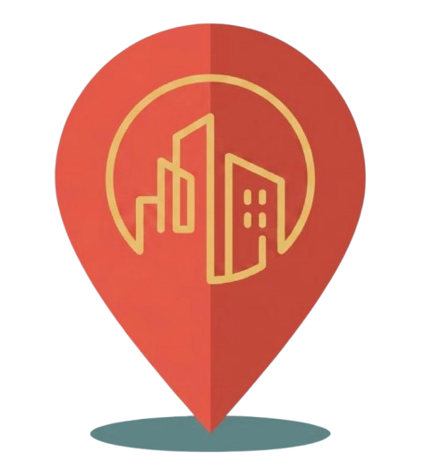
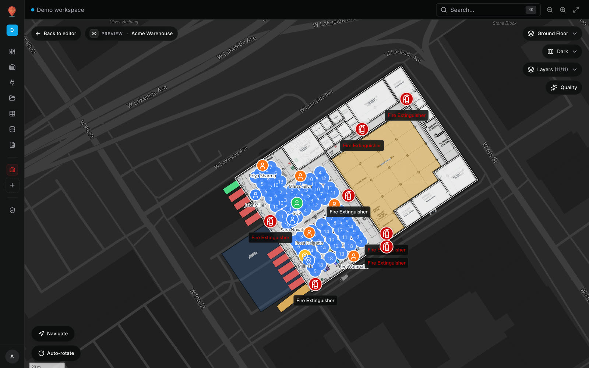
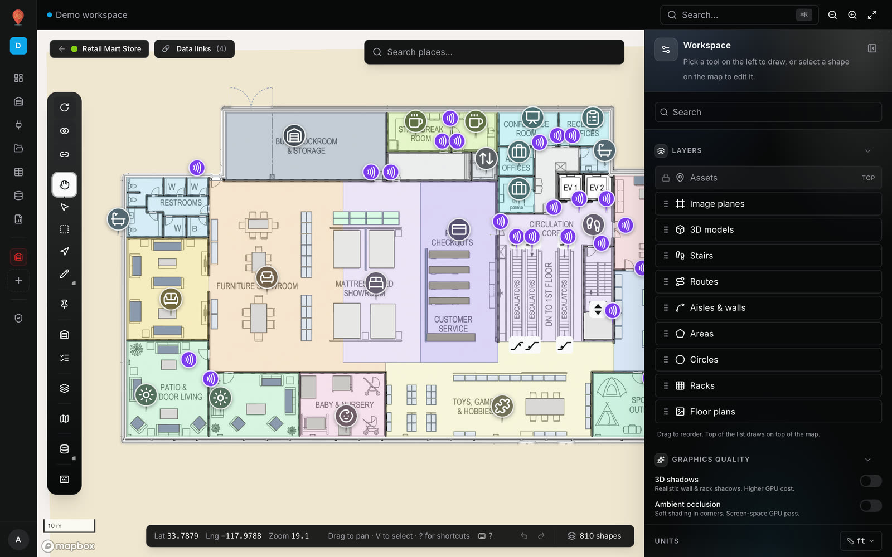
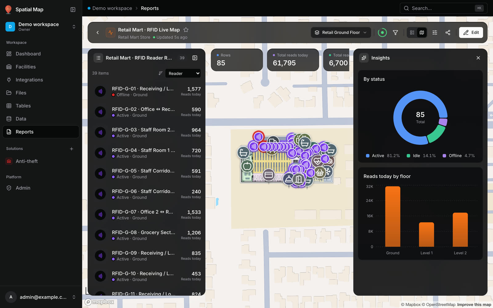
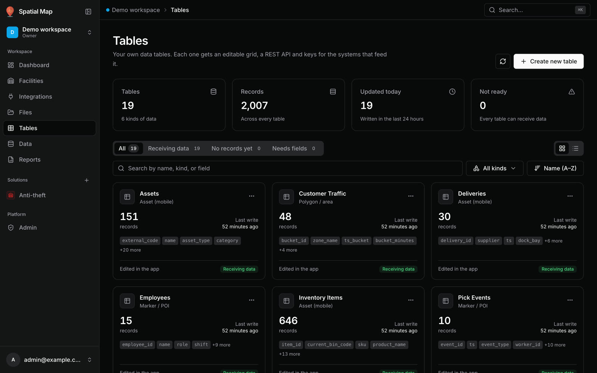

<div align="center">



# Spatial Map

**Open-source indoor mapping for real facilities** — draw multi-floor layouts on
a live map, link them to your own data (sensors, RFID, inventory, any table or
API), and turn it into live 3D views, dashboards and reports.

[](https://github.com/Siraj-zaki/spatial-map/actions/workflows/ci.yml)
[](https://github.com/Siraj-zaki/spatial-map/releases)
[](LICENSE)

[**Documentation**](https://spatialmap.io/docs) ·
[**Cloud version**](https://spatialmap.io) ·
[Quick start](#quick-start) ·
[Releases](https://github.com/Siraj-zaki/spatial-map/releases) ·
[Contributing](CONTRIBUTING.md)


</div>

---

## What it does

| | |
|---|---|
|  | **Live 3D viewer** — every floor, rack, bin, area and 3D model on a real map, with live data from your systems coloured and labelled by your own rules. Share read-only links with chosen floors, layers and filters. |
|  | **Facility editor** — import floor plans (PDF, DWG, images) and draw areas, walls, doors, stairs, lifts, racks, markers, labels and 3D models, with snapping, bulk editing, undo/redo and keyboard shortcuts. |
|  | **Reports & dashboards** — a report builder with KPIs, charts, tables and filters, ready-made reports for every facility and data table, and a full-map layout that auto-refreshes. |
|  | **Tables & data links** — built-in tables with CSV/XLSX import and a REST API per table, or pull from REST APIs, webhooks, files and live streams; link any row to a shape by name, code or coordinates. |

Also: workspaces with roles (owner / admin / editor / viewer), solutions to
group facilities and reports, an optional AI tool that detects rooms and walls
on a floor plan, six languages (incl. RTL), light/dark themes and 46 palettes.
Self-hosted means everything is unlocked: no plans, no limits.

> **Prefer not to host it yourself?** [spatialmap.io](https://spatialmap.io) is
> the managed cloud version of Spatial Map.

---

## Quick start

**You need** [Docker](https://docs.docker.com/get-docker/) (Compose v2.20+)
and a free [Mapbox access token](https://account.mapbox.com/access-tokens/).

```bash
git clone https://github.com/Siraj-zaki/spatial-map.git
cd spatial-map
cp .env.example .env          # set VITE_MAPBOX_ACCESS_TOKEN=pk....
docker compose up -d          # first run builds the images (a few minutes)
```

Open **http://localhost:3000** and **sign up**. Without SMTP configured, the
email code is printed in the API log:

```bash
docker compose logs api | grep -i "verification code"
```

To skip the build and use the published images, run `docker compose pull`
before `up`. To create an admin account on first start, set
`SPATIAL_MAP_ADMIN_EMAIL` / `SPATIAL_MAP_ADMIN_PASSWORD` in `.env`. The
optional AI floor-plan tool adds a ~1.7 GB worker:
`docker compose --profile ai up -d`.

### Demo workspace

A fresh install comes with a shared **Demo workspace** — five sample
facilities (a hospital, a retail mall, a warehouse, a supermarket and a retail
store) with floors, racks, live data tables, data links and 84 ready-made
reports, including a full-map RFID dashboard. It is loaded once, on the first
start of an empty database; every new account joins it as an editor and lands
there first, next to a workspace of its own. Delete it from **Workspaces** when
you no longer need it, or set `SPATIAL_MAP_DEMO=false` **before the first
start** to begin empty.

### Send it your data

Every table has its own REST API and bearer tokens (**Tables → your table →
API & Integrations**). Push a row from anywhere:

```bash
curl -X POST http://localhost:3000/api/v1/public/tables/rows \
  -H "Authorization: Bearer $SPATIAL_MAP_TABLE_TOKEN" \
  -H "Content-Type: application/json" \
  -d '{"entityKey": "cam-07", "payload": {"name": "Camera 7", "status": "online"}, "position": [-81.7006, 41.5004]}'
```

Then link the table to a facility in the editor (**Data links**) and the row
shows up on the map, styled by your rules, as soon as it changes.

---

## Documentation

The user guide lives at **[spatialmap.io/docs](https://spatialmap.io/docs)**:

- [Getting started](https://spatialmap.io/docs/getting-started) ·
  [Facilities](https://spatialmap.io/docs/facilities)
- [Editor overview](https://spatialmap.io/docs/editor-overview) ·
  [Keyboard shortcuts](https://spatialmap.io/docs/keyboard-shortcuts) ·
  [Floor plans](https://spatialmap.io/docs/tool-floor-plan)
- [Viewer](https://spatialmap.io/docs/viewer-overview) ·
  [Share links](https://spatialmap.io/docs/share-links-overview)
- [Data links](https://spatialmap.io/docs/data-link-overview) ·
  [Integrations](https://spatialmap.io/docs/integrations) ·
  [Tables & REST API](https://spatialmap.io/docs/tables)

The guide describes the cloud version; the self-hosted edition is the same app
without plans or billing. Technical docs for running and changing the code are
in this repository:

| | |
|---|---|
| [ARCHITECTURE.md](ARCHITECTURE.md) | Every file, route, table and design decision |
| [docs/](docs/) | Frontend, backend, pitfalls, CAD import, AI tool, workflow |
| [AGENTS.md](AGENTS.md) | Conventions for contributors and AI coding agents |
| [SECURITY.md](SECURITY.md) | Production hardening and reporting vulnerabilities |

---

## Configuration

All settings for `docker compose` go in `.env` — every option is documented in
[.env.example](.env.example). The ones you'll want for production:

| Variable | What |
|---|---|
| `VITE_MAPBOX_ACCESS_TOKEN` | **Required.** Mapbox public token (set at container start, no rebuild) |
| `SPATIAL_MAP_PUBLIC_URL` | Public URL of the app, used in auth emails |
| `SPATIAL_MAP_MODE=production` | Refuses to start with placeholder secrets |
| `SPATIAL_MAP_JWT_SECRET`, `SPATIAL_MAP_API_KEY` | Session signing secret and machine API key (`openssl rand -hex 32` each) |
| `SPATIAL_MAP_DB_PASSWORD`, `SPATIAL_MAP_MINIO_USER/PASSWORD` | Database and object-storage credentials (set before the first start) |
| `SPATIAL_MAP_SMTP_*` | SMTP for sign-up and password-reset codes |
| `SPATIAL_MAP_PORT` | Port the app is served on (default `3000`) |
| `SPATIAL_MAP_DEMO` | Load the demo workspace into an empty database (default `true`) |

Put a TLS-terminating reverse proxy (Caddy, nginx, Traefik) in front of port
3000 for anything public. The API reads `SGV_*` settings as well
(`backend/config.prod.example.yaml` documents each one) — see
[SECURITY.md](SECURITY.md).

Basemaps come from Mapbox's public styles ([map-styles.json](map-styles.json));
point an entry at your own Mapbox Studio style to change the look.

---

## Development

```bash
cp .env.example .env                                  # set VITE_MAPBOX_ACCESS_TOKEN
docker compose -f backend/docker-compose.yml up -d    # Postgres, MinIO, Redis + API on :8080
npm install && npm run dev                            # SPA on http://localhost:5173
```

```bash
npx tsc -p tsconfig.app.json --noEmit    # typecheck
npm run lint                             # ESLint
npm run build                            # production build
npm run e2e                              # Playwright (needs the backend running)
cd backend && make test                  # Go tests (testcontainers → needs Docker)
cd backend && make sqlc                  # regenerate DB code after editing queries/*.sql
```

```
src/            React 19 + TypeScript SPA (routes, components, stores, map overlays, reports)
public/         static assets, locales (6 languages), bundled 3D models
backend/        Go API (cmd/, internal/, migrations/, queries/ for sqlc)
backend/ai-worker/  optional Python CV worker for the AI floor-plan tool
docker/         web container (nginx + runtime config)
worker/         optional Cloudflare Worker for local pub/sub / webhook testing
scripts/        model build, thumbnails, seeders, live-feed simulator
e2e/            Playwright end-to-end tests
```

Stack: React 19 · TypeScript · Vite · Mapbox GL 3 · Zustand · Tailwind ·
shadcn/ui · Go 1.25 · Chi · sqlc · PostgreSQL/PostGIS · MinIO · Redis.

---

## Contributing

Issues and pull requests are welcome — read [CONTRIBUTING.md](CONTRIBUTING.md)
and [AGENTS.md](AGENTS.md) first (the codebase has a few firm conventions:
spatial store, tenant scoping, i18n in six languages, theme tokens), and follow
the [Code of Conduct](CODE_OF_CONDUCT.md). Report security issues privately
([SECURITY.md](SECURITY.md)). Changes are listed in [CHANGELOG.md](CHANGELOG.md).

## License

[MIT](LICENSE) © Spatial Map contributors. Bundled 3D models are CC BY 4.0 and
need attribution — see [CREDITS.md](CREDITS.md). Map data and tiles are
© Mapbox and © OpenStreetMap contributors.
