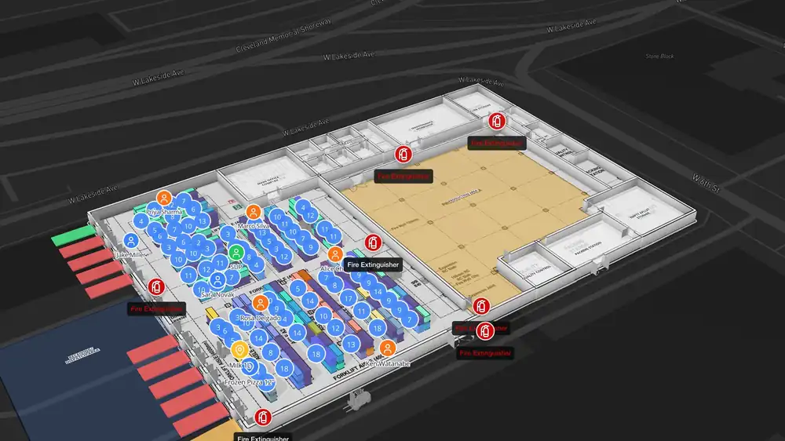
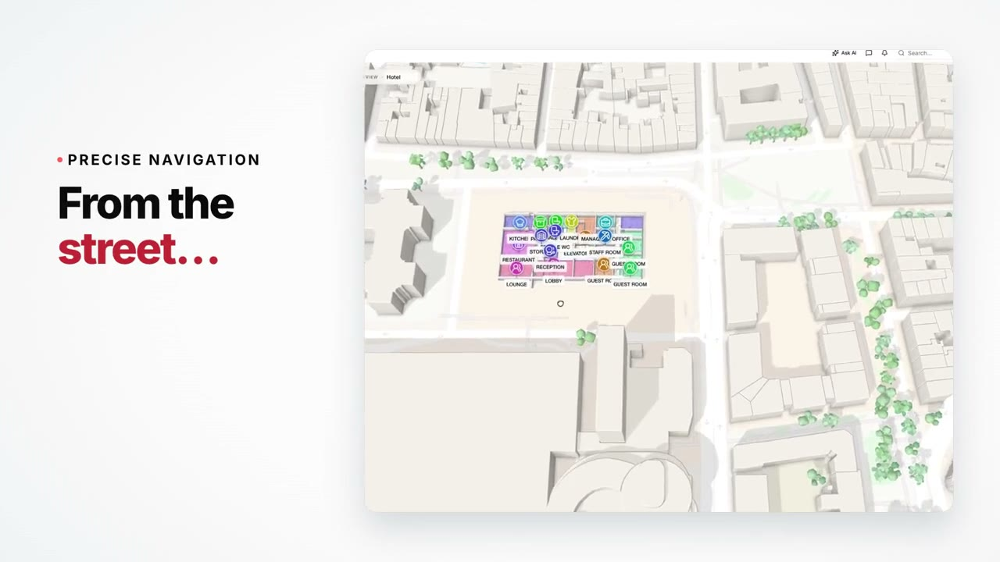
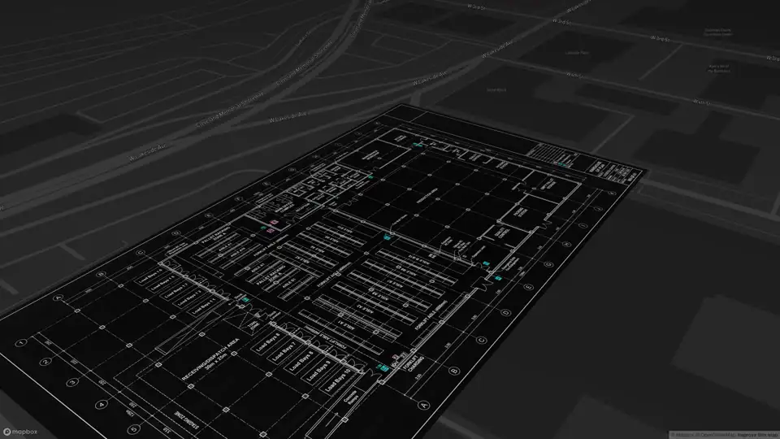
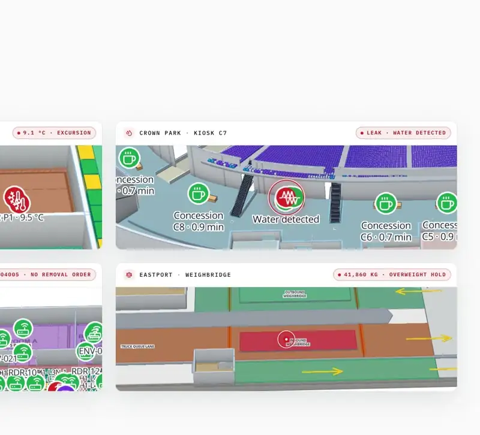

<div dir="rtl">

<div align="center">


# Spatial Map — برنامج مفتوح المصدر لخرائط المباني الداخلية

[English](../../README.md) · [Español](README.es.md) · [Français](README.fr.md) · [Deutsch](README.de.md) · [中文](README.zh-CN.md) · **العربية**

**حوّل مخططات CAD وDWG وPDF إلى خرائط داخلية ثلاثية الأبعاد حيّة وتوائم رقمية.**
ارسم المستودعات والمستشفيات ومراكز التسوق والمصانع والحرم الجامعية طابقًا
طابقًا، واربط البيانات الحيّة من أنظمة RTLS وRFID وBLE وحساسات إنترنت الأشياء،
ومن نظام WMS أو ERP، أو من أي جدول أو Webhook أو واجهة API، وتابعها على الخريطة
بالخرائط الحرارية والتنبيهات والملاحة الداخلية ولوحات المتابعة والتقارير.
استضافة ذاتية عبر Docker، برخصة MIT.

[](https://github.com/Siraj-zaki/spatial-map/actions/workflows/ci.yml)
[](https://github.com/Siraj-zaki/spatial-map/releases)
[](../../LICENSE)

[**التوثيق**](https://spatialmap.io/docs) ·
[**النسخة السحابية**](https://spatialmap.io) ·
[البدء السريع](#البدء-السريع) ·
[الإصدارات](https://github.com/Siraj-zaki/spatial-map/releases)



<a href="../media/spatial-map-tour.mp4"></a>


▶ [**شاهد جولة مدتها 50 ثانية**](../media/spatial-map-tour.mp4) · من مخطط CAD إلى خريطة مستودع حيّة

</div>

---

## المزايا

### من المخطط إلى خريطة داخلية حيّة

| | |
|---|---|
|  | **استورد أي مخطط**: PDF أو DWG (AutoCAD) أو صورة، يوضع على خريطة حقيقية ويُضبط مقياسه بأداة **المعايرة** (قياس طول معروف). ارسم جدرانًا **تلتقي بدقة عند الزوايا**، وجدرانًا مائلة، ومناطق وأبوابًا وسلالم ومصاعد وسلالم كهربائية، و**رفوفًا بمواقع تخزين** (مستقيمة أو **على امتداد مسار**)، وعلامات ونصوصًا ونماذج ثلاثية الأبعاد. أداة **القياس** (`U`) والأبعاد الحيّة و**إدخال الأطوال** (`3.5`، `350cm`، `12'6`) تمنحك دقة برامج CAD. |
|  | **مبانٍ متعددة الطوابق بالأبعاد الثلاثة**: كل طابق على ارتفاعه الحقيقي، مع عروض مرجعية لكل طابق، وورقة فارغة للطوابق بلا مخطط، وتحرير جماعي، وتراجع/إعادة، واختصارات لوحة المفاتيح، و**تصدير** إلى GeoJSON وCSV وXLSX و**نماذج `.glb` ثلاثية الأبعاد**. |
|  | **عارض ثلاثي الأبعاد حي وتوأم رقمي**: كل طابق ورف وموقع ومنطقة ونموذج على خريطة حقيقية، مع بيانات حيّة ملوّنة حسب قواعدك. **وضع التركيز** يخفّف فقط ما يحجب العنصر الذي تختاره. شارك روابط للعرض فقط. |

### البيانات الحيّة: RTLS وRFID وBLE وإنترنت الأشياء وWMS وERP

| | |
|---|---|
|  | **روابط البيانات**: اربط صفوف الجداول وواجهات REST وWebhooks والملفات وتدفقات WebSocket بالأشكال حسب الاسم أو الرمز أو الإحداثيات. مواقع RTLS وقراءات RFID ووسوم BLE وقيم الحساسات وسجلات WMS / ERP تصل بالطريقة نفسها. **إعادة تشغيل السجل** بنطاق زمني تعرض أي لحظة. |
|  | **التنبيهات** (جديد في 0.3.0): قواعد على أي جدول (شرط أو مدة أو قيمة متقادمة أو عدد)، يقيّمها الخادم كل 15 ثانية، وتظهر في مكانها على الخريطة مع جرس وصوت تنبيه. |
|  | **التقارير ولوحات المتابعة**: مؤشرات أداء ورسوم بيانية وجداول وعوامل تصفية، و**تقرير رئيسي** لكل منشأة، وتقارير جاهزة لكل منشأة وجدول، و**خرائط حرارية** تتوقف عند الجدران، و**تجميع النقاط**، و**روابط عامة لتقرير واحد**. |

### الملاحة الداخلية

| | |
|---|---|
|  | **ملاحة داخلية خطوة بخطوة**: مسارات تتبع محاور المبنى وتمر عبر منتصف الأبواب و**تنتقل بين الطوابق** عبر السلالم والمصاعد. **البحث عن الأماكن** يجد العناوين والإحداثيات وروابط Google Maps / OpenStreetMap. |

### وأيضًا

- **مساحات عمل وأعضاء وأدوار مخصصة**؛ يمكن للمسؤولين إنشاء الحسابات مباشرة؛ والمشاهدون للقراءة فقط حتى عبر واجهة API.
- **جداول** مع استيراد CSV/XLSX وواجهة REST ورموز وصول لكل جدول، ومصادر استطلاع وسجل للصفوف.
- **الحلول** لتجميع المنشآت والتقارير والبيانات.
- **ست لغات** (الإنجليزية والإسبانية والفرنسية والألمانية والصينية والعربية مع دعم الكتابة من اليمين إلى اليسار)، وسمات فاتحة/داكنة و46 لوحة ألوان.
- **الاستضافة الذاتية تعني فتح كل شيء**: بلا خطط ولا حدود ولا تتبّع.

> **تفضّل عدم الاستضافة بنفسك؟** [spatialmap.io](https://spatialmap.io) هي النسخة السحابية المُدارة.

---

## حالات الاستخدام

| | |
|---|---|
| **المستودعات والخدمات اللوجستية (WMS)** | رفوف ومواقع ملوّنة حسب المخزون، ومسارات الالتقاط، وأبواب التحميل، والرافعات والعمال على الخريطة |
| **المستشفيات والرعاية الصحية (RTLS)** | مواقع الطاقم والمرضى والمعدات، وإشغال الغرف، وتنبيهات سلسلة التبريد |
| **التجزئة ومراكز التسوق والمتاجر** | مخططات المتاجر، وخرائط حرارية لحركة الزوار، وتنبيهات مكافحة السرقة، والإرشاد داخل المتجر |
| **المصانع (إنترنت الأشياء)** | الآلات والحساسات على المخطط، والحالة الحيّة، وتنبيهات الصيانة والسلامة |
| **المكاتب والحرم الجامعية والقاعات والمتاحف** | الغرف والمكاتب والأصول، وإرشاد الزوار |

---

## البدء السريع

**تحتاج إلى** [Docker](https://docs.docker.com/get-docker/) (Compose v2.20+) و[رمز وصول Mapbox](https://account.mapbox.com/access-tokens/) مجاني.

</div>

```bash
git clone https://github.com/Siraj-zaki/spatial-map.git
cd spatial-map
cp .env.example .env          # set VITE_MAPBOX_ACCESS_TOKEN=pk....
docker compose up -d
```

<div dir="rtl">

افتح **http://localhost:3000** و**أنشئ حسابًا**. إذا لم يكن SMTP مضبوطًا، يظهر رمز التحقق في سجل الواجهة البرمجية:

</div>

```bash
docker compose logs api | grep -i "verification code"
```

<div dir="rtl">

يأتي التثبيت الجديد مع **مساحة عمل تجريبية** تضم خمس منشآت نموذجية و84 تقريرًا. للبدء بمساحة فارغة اضبط `SPATIAL_MAP_DEMO=false` **قبل التشغيل الأول**.

### أرسل بياناتك

لكل جدول واجهة REST ورموز وصول خاصة به. أرسل صفًا من خادم RTLS أو بوابة إنترنت أشياء أو نظام WMS أو ERP أو من سكربت:

</div>

```bash
curl -X POST http://localhost:3000/api/v1/public/tables/rows \
  -H "Authorization: Bearer $SPATIAL_MAP_TABLE_TOKEN" \
  -H "Content-Type: application/json" \
  -d '{"entityKey": "cam-07", "payload": {"name": "Camera 7", "status": "online"}, "position": [-81.7006, 41.5004]}'
```

<div dir="rtl">

اربط الجدول بمنشأة في المحرر (**روابط البيانات**) وسيظهر الصف على الخريطة فور تغيّره.

---

## الإعداد والتطوير والتوثيق

- جميع خيارات `docker compose` موجودة في [.env.example](../../.env.example)؛ والجدول الكامل في [ملف README الإنجليزي](../../README.md#configuration).
- دليل المستخدم: **[spatialmap.io/docs](https://spatialmap.io/docs)**.
- التوثيق التقني: [ARCHITECTURE.md](../../ARCHITECTURE.md) و[docs/](../) و[AGENTS.md](../../AGENTS.md) و[SECURITY.md](../../SECURITY.md).
- التقنيات: React 19 · TypeScript · Vite · Mapbox GL 3 · Go 1.25 · PostgreSQL/PostGIS · MinIO · Redis.

## المساهمة والترخيص

نرحّب بالبلاغات وطلبات الدمج؛ اقرأ [CONTRIBUTING.md](../../CONTRIBUTING.md) أولًا. إن كان Spatial Map مفيدًا لك، فإن ⭐ تساعد الآخرين على اكتشافه.

[MIT](../../LICENSE) © المساهمون في Spatial Map. النماذج ثلاثية الأبعاد المرفقة مرخّصة بـ CC BY 4.0 ([CREDITS.md](../../CREDITS.md)). بيانات الخرائط © Mapbox و© المساهمون في OpenStreetMap.

</div>
