<div align="center">


# Spatial Map — Open-Source-Software für Indoor-Karten

[English](../../README.md) · [Español](README.es.md) · [Français](README.fr.md) · **Deutsch** · [中文](README.zh-CN.md) · [العربية](README.ar.md)

**Machen Sie aus CAD-, DWG- und PDF-Grundrissen live 3D-Indoor-Karten und digitale Zwillinge.**
Bilden Sie Lager, Krankenhäuser, Einkaufszentren, Fabriken und Campus Etage für
Etage ab, verbinden Sie Live-Daten aus RTLS, RFID, BLE und IoT-Sensoren, Ihrem
WMS oder ERP oder jeder Tabelle, jedem Webhook und jeder API, und verfolgen Sie
sie auf der Karte mit Heatmaps, Alarmen, Navigation, Dashboards und Berichten.
Selbst gehostet mit Docker. MIT.

[](https://github.com/Siraj-zaki/spatial-map/actions/workflows/ci.yml)
[](https://github.com/Siraj-zaki/spatial-map/releases)
[](../../LICENSE)

[**Dokumentation**](https://spatialmap.io/docs) ·
[**Cloud-Version**](https://spatialmap.io) ·
[Schnellstart](#schnellstart) ·
[Releases](https://github.com/Siraj-zaki/spatial-map/releases)

<a href="../media/spatial-map-overview.mp4">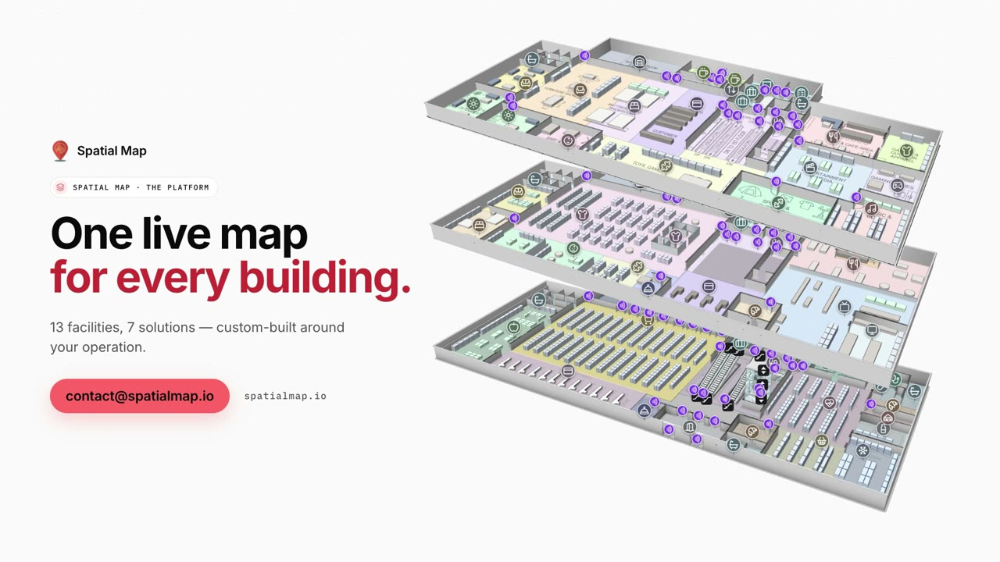</a>

▶ [**Die 90-Sekunden-Übersicht ansehen**](../media/spatial-map-overview.mp4)

</div>

---

## Galerie

Eine App für jede Art von Gebäude. Jedes Bild ist ein in Spatial Map erstellter Standort: Etagen über dem echten Grundriss gezeichnet, Live-Daten darüber.

| | |
|---|---|
| 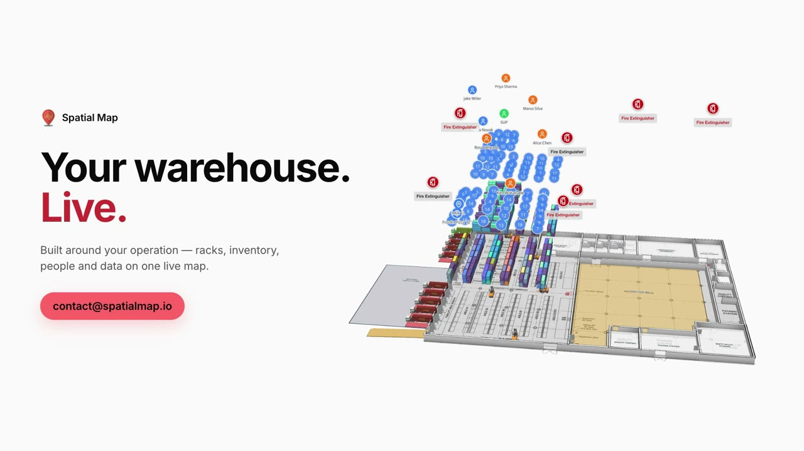 **Lager**: Regale, Bestand, Personen und Sicherheit | 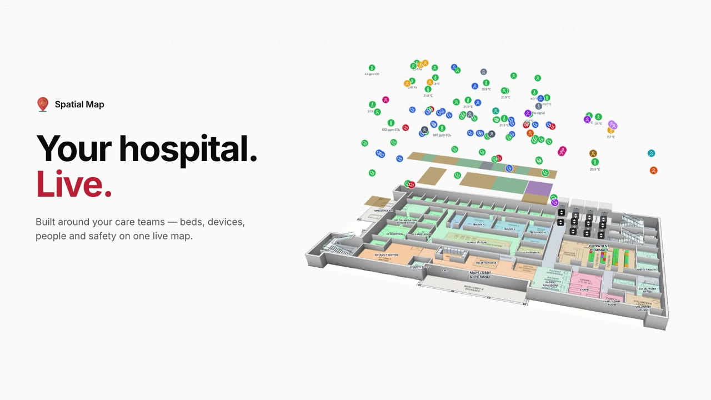 **Krankenhäuser**: Betten, Geräte, Personal und Sicherheit |
| 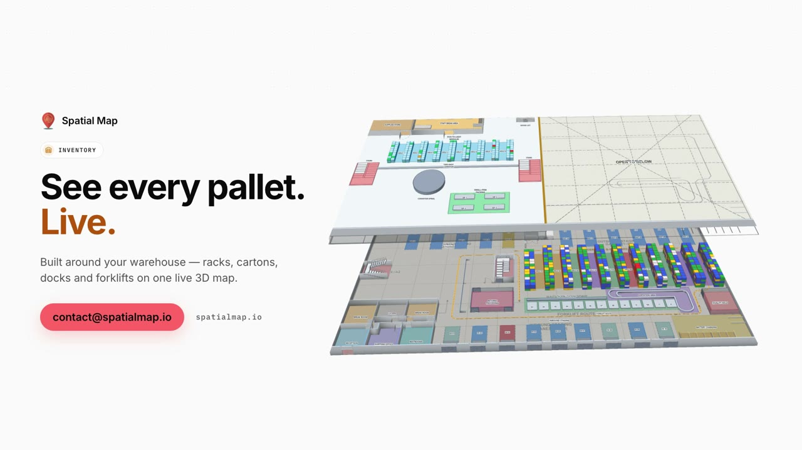 **Bestand**: jedes Regal, jeder Karton, jedes Tor und jeder Stapler | 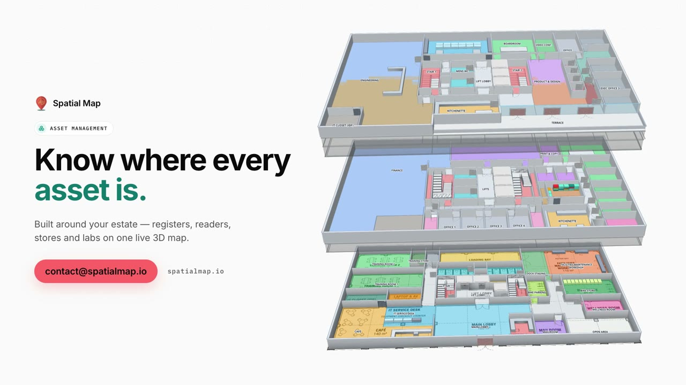 **Anlagenverwaltung**: Tags, Lesegeräte und Anlagen über mehrere Etagen |
| 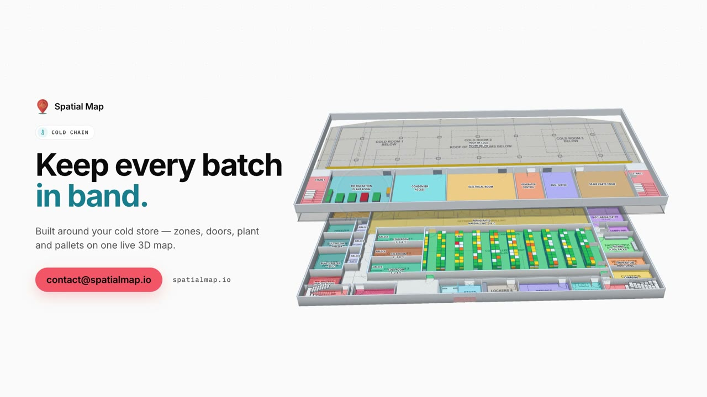 **Kühlkette**: Zonen, Türen und Temperaturalarme | 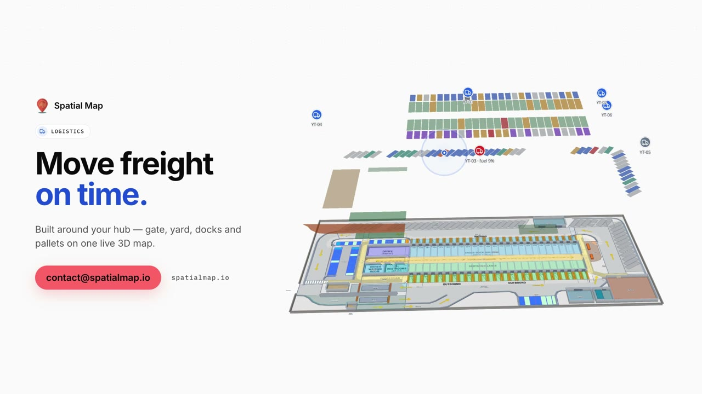 **Logistik**: Tore, Hof, Rampen und Paletten |
| 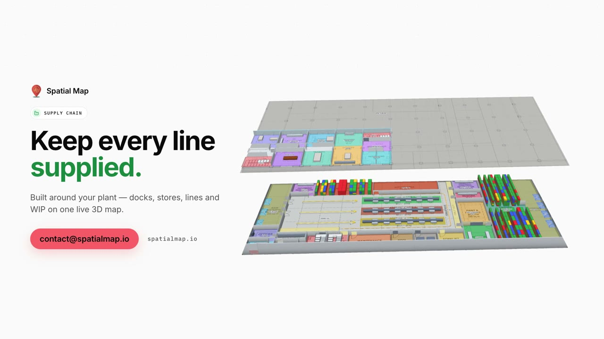 **Fertigung und Lieferkette**: Rampen, Lager, Linien und WIP | 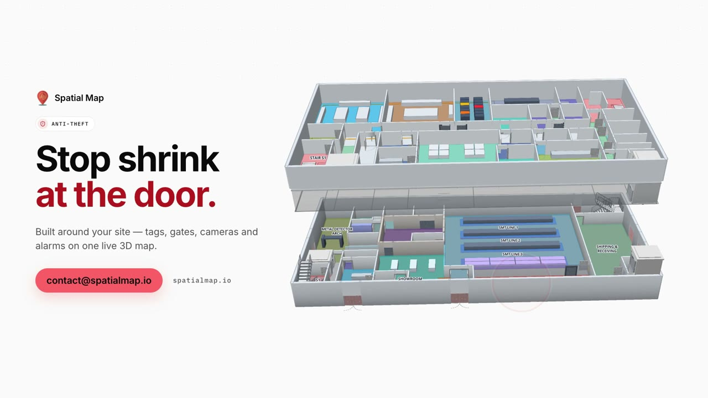 **Diebstahlschutz**: RFID-Tags, Schleusen, Kameras und Alarme |
| 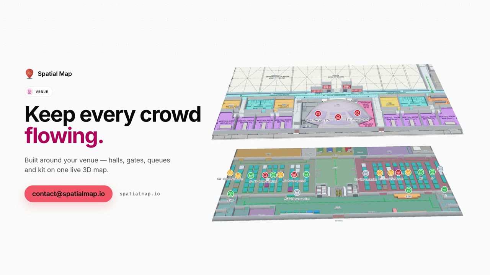 **Veranstaltungsorte und Stadien**: Hallen, Eingänge, Schlangen und Ausrüstung | 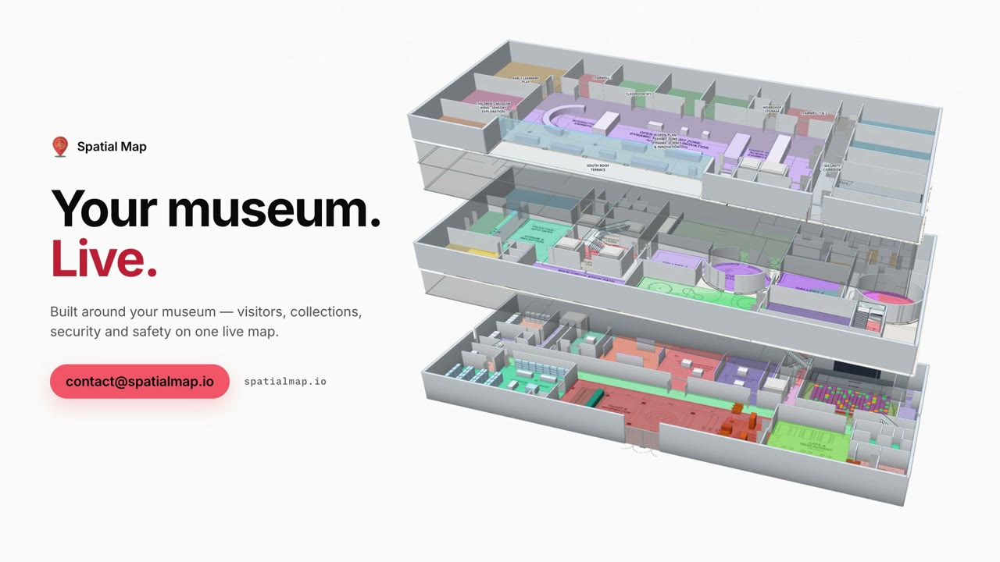 **Museen**: Besucher, Sammlungen und Sicherheit |
| 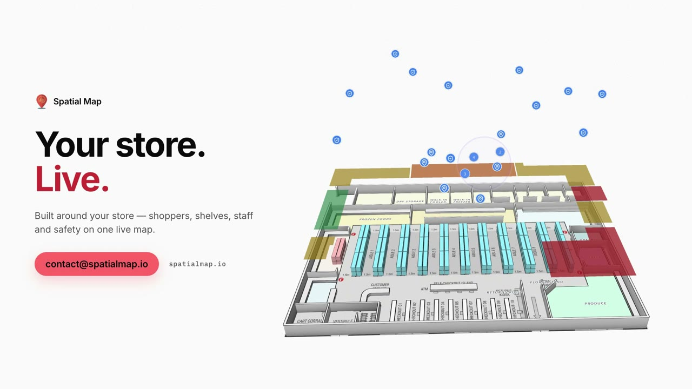 **Handel und Supermärkte**: Kunden, Regale und Personal | 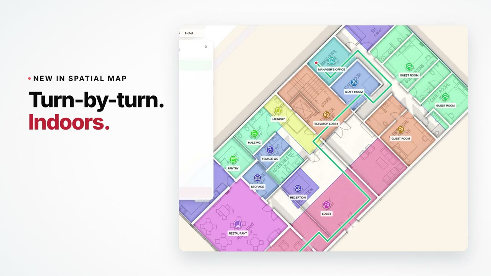 **Indoor-Navigation**: Schritt für Schritt, über Etagen hinweg |

---

## Funktionen

### Vom Grundriss zur Live-Indoor-Karte

| | |
|---|---|
|  | **Jeden Grundriss importieren**: PDF, DWG (AutoCAD) oder Bild, auf einer echten Karte platziert und per **Kalibrierung** skaliert (eine bekannte Länge messen). Zeichnen Sie Wände, die **sauber an Ecken anschließen**, geneigte Wände, Flächen, Türen, Treppen, Aufzüge und Rolltreppen, **Regale mit Fächern** (gerade oder **entlang eines Pfads**), Marker, Beschriftungen und 3D-Modelle. Das **Messwerkzeug** (`U`), Live-Maße und **eingetippte Längen** (`3.5`, `350cm`, `12'6`) sorgen für CAD-Genauigkeit. |
| 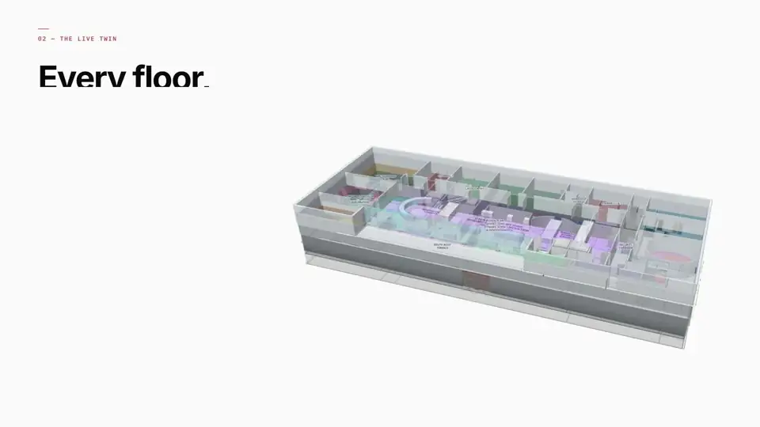 | **Mehrstöckige Gebäude in 3D**: jede Etage in ihrer echten Höhe, Referenzansichten pro Etage, leeres Blatt für Etagen ohne Plan, Massenbearbeitung, Rückgängig/Wiederholen, Tastenkürzel und **Export** als GeoJSON, CSV, XLSX und **3D `.glb`**. |
|  | **Live-3D-Ansicht und digitaler Zwilling**: jede Etage, jedes Regal, Fach, jede Fläche und jedes 3D-Modell auf einer echten Karte, Live-Daten nach Ihren Regeln eingefärbt. Der **Fokusmodus** blendet nur aus, was das gewählte Element verdeckt. Teilen Sie schreibgeschützte Links. |

### Live-Daten: RTLS, RFID, BLE, IoT, WMS und ERP

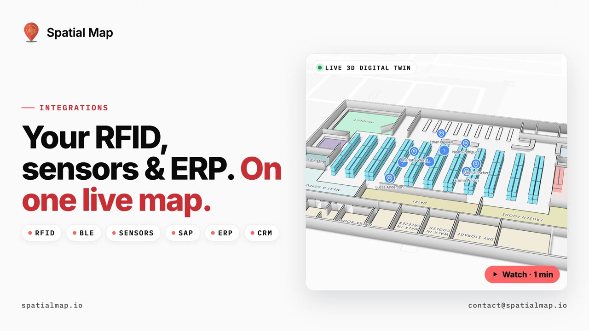

| | |
|---|---|
|  | **Datenverknüpfungen**: Zeilen aus Tabellen, REST-APIs, Webhooks, Dateien oder WebSocket-Streams per Name, Code oder Koordinaten mit Formen verbinden. RTLS-Positionen, RFID-Lesungen, BLE-Tags, Sensorwerte und WMS-/ERP-Datensätze kommen auf demselben Weg. Die **Verlaufswiedergabe** mit Zeitraum zeigt jeden Moment erneut. |
|  | **Alarme** (neu in 0.3.0): Regeln für jede Tabelle (Bedingung, Dauer, veralteter Wert oder Anzahl), alle 15 s auf dem Server geprüft, auf der Karte verortet, mit Glocke und Signalton. |
|  | **Berichte und Dashboards**: KPIs, Diagramme, Tabellen und Filter, ein **Master-Bericht** pro Standort, fertige Berichte für jeden Standort und jede Tabelle, **Heatmaps**, die an Wänden enden, **Punkt-Clustering** und **öffentliche Links zu einem Bericht**. |

### Wegfindung

| | |
|---|---|
| 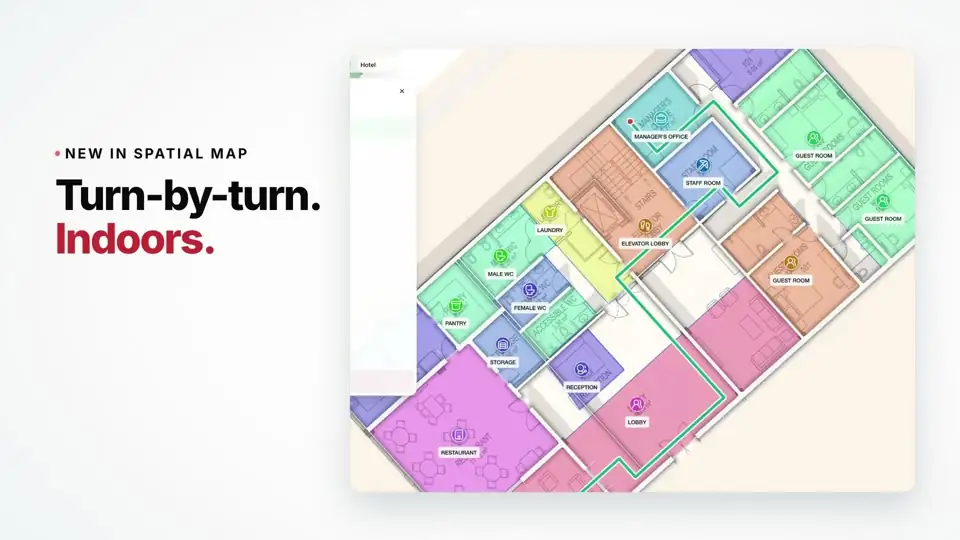 | **Indoor-Navigation Schritt für Schritt**: Routen folgen den Gebäudeachsen, führen durch die Türmitte und **wechseln die Etage** über Treppen und Aufzüge. Die **Ortssuche** findet Adressen, Koordinaten und Google-Maps-/OpenStreetMap-Links. |

### Außerdem

- **Arbeitsbereiche, Mitglieder und eigene Rollen**; Admins können Konten direkt anlegen; Betrachter haben auch über die API nur Lesezugriff.
- **Tabellen** mit CSV-/XLSX-Import, REST-API und Tokens pro Tabelle, Abfragequellen und Zeilenverlauf.
- **Lösungen** bündeln Standorte, Berichte und Daten.
- **Sechs Sprachen** (Englisch, Spanisch, Französisch, Deutsch, Chinesisch, Arabisch mit RTL), helles/dunkles Design und 46 Farbpaletten.
- **Selbst gehostet = alles freigeschaltet**: keine Tarife, keine Limits, keine Telemetrie.

> **Lieber nicht selbst hosten?** [spatialmap.io](https://spatialmap.io) ist die verwaltete Cloud-Version.

---

## Einsatzbereiche

| | |
|---|---|
| **Lager und Logistik (WMS)** | Regale und Fächer nach Bestand, Kommissionierwege, Tore, Stapler und Kommissionierer auf der Karte |
| **Krankenhäuser (RTLS)** | Standorte von Personal, Patienten und Geräten, Raumbelegung, Kühlketten-Alarme |
| **Handel, Einkaufszentren, Supermärkte** | Ladenpläne, Besucher-Heatmaps, Diebstahlalarme, Wegfindung im Laden |
| **Fertigung (IoT)** | Maschinen und Sensoren im Grundriss, Live-Status, Wartungs- und Sicherheitsalarme |
| **Büros, Campus, Veranstaltungsorte, Museen** | Räume, Arbeitsplätze und Anlagen, Besucherführung |

---

## Schnellstart

**Sie brauchen** [Docker](https://docs.docker.com/get-docker/) (Compose v2.20+) und ein kostenloses [Mapbox-Zugriffstoken](https://account.mapbox.com/access-tokens/).

```bash
git clone https://github.com/Siraj-zaki/spatial-map.git
cd spatial-map
cp .env.example .env          # VITE_MAPBOX_ACCESS_TOKEN=pk.... setzen
docker compose up -d          # der erste Start baut die Images (einige Minuten)
```

Öffnen Sie **http://localhost:3000** und **registrieren Sie sich**. Ohne SMTP steht der Bestätigungscode im API-Log:

```bash
docker compose logs api | grep -i "verification code"
```

Eine neue Installation enthält einen **Demo-Arbeitsbereich** mit fünf Beispielstandorten und 84 Berichten. Mit `SPATIAL_MAP_DEMO=false` **vor dem ersten Start** beginnen Sie leer.

### Daten senden

Jede Tabelle hat eine eigene REST-API und eigene Tokens. Senden Sie eine Zeile von einem RTLS-Server, einem IoT-Gateway, Ihrem WMS oder ERP oder einem Skript:

```bash
curl -X POST http://localhost:3000/api/v1/public/tables/rows \
  -H "Authorization: Bearer $SPATIAL_MAP_TABLE_TOKEN" \
  -H "Content-Type: application/json" \
  -d '{"entityKey": "cam-07", "payload": {"name": "Camera 7", "status": "online"}, "position": [-81.7006, 41.5004]}'
```

Verknüpfen Sie die Tabelle im Editor mit einem Standort (**Datenverknüpfungen**): Die Zeile erscheint auf der Karte, sobald sie sich ändert.

---

## Konfiguration, Entwicklung und Dokumentation

- Alle Optionen für `docker compose` stehen in [.env.example](../../.env.example); die vollständige Tabelle steht im [englischen README](../../README.md#configuration).
- Benutzerhandbuch: **[spatialmap.io/docs](https://spatialmap.io/docs)**.
- Technische Dokumentation: [ARCHITECTURE.md](../../ARCHITECTURE.md), [docs/](../), [AGENTS.md](../../AGENTS.md), [SECURITY.md](../../SECURITY.md).
- Stack: React 19 · TypeScript · Vite · Mapbox GL 3 · Go 1.25 · PostgreSQL/PostGIS · MinIO · Redis.

## Mitwirken und Lizenz

Issues und Pull Requests sind willkommen: Lesen Sie [CONTRIBUTING.md](../../CONTRIBUTING.md). Wenn Ihnen Spatial Map hilft, hilft ein ⭐ anderen, es zu finden.

[MIT](../../LICENSE) © Spatial-Map-Mitwirkende. Mitgelieferte 3D-Modelle stehen unter CC BY 4.0 ([CREDITS.md](../../CREDITS.md)). Kartendaten © Mapbox und © OpenStreetMap-Mitwirkende.
