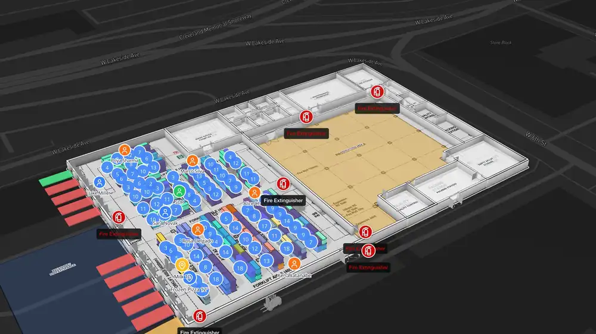
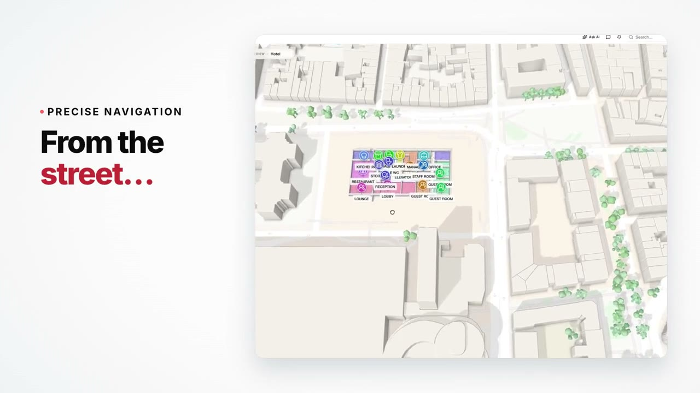
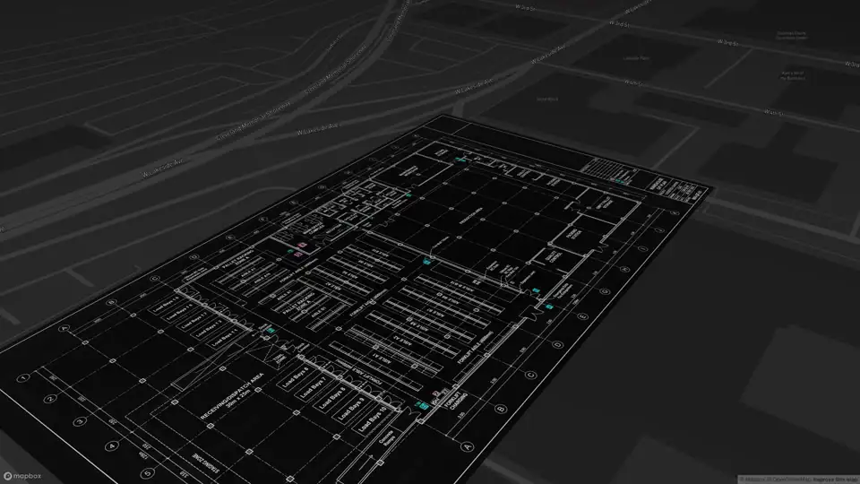

<div align="center">


# Spatial Map — software de mapas de interiores de código abierto

[English](../../README.md) · **Español** · [Français](README.fr.md) · [Deutsch](README.de.md) · [中文](README.zh-CN.md) · [العربية](README.ar.md)

**Convierte planos CAD, DWG y PDF en mapas de interiores 3D en vivo y gemelos digitales.**
Mapea almacenes, hospitales, centros comerciales, fábricas y campus planta por
planta, conecta datos en vivo de RTLS, RFID, BLE y sensores IoT, tu WMS o ERP,
o cualquier tabla, webhook o API, y míralos en el mapa con mapas de calor,
alertas, navegación paso a paso, paneles e informes. Autoalojado con Docker. MIT.

[](https://github.com/Siraj-zaki/spatial-map/actions/workflows/ci.yml)
[](https://github.com/Siraj-zaki/spatial-map/releases)
[](../../LICENSE)

[**Documentación**](https://spatialmap.io/docs) ·
[**Versión en la nube**](https://spatialmap.io) ·
[Inicio rápido](#inicio-rápido) ·
[Versiones](https://github.com/Siraj-zaki/spatial-map/releases)



<a href="../media/spatial-map-tour.mp4"></a>


▶ [**Ver el recorrido de 50 segundos**](../media/spatial-map-tour.mp4) · de un plano CAD a un mapa de almacén en vivo

</div>

---

## Funciones

### Del plano al mapa de interiores en vivo

| | |
|---|---|
|  | **Importa cualquier plano**: PDF, DWG (AutoCAD) o imagen, colocado sobre un mapa real y escalado con la herramienta de **calibración** (mide una longitud conocida). Dibuja muros que **se unen limpiamente en las esquinas**, muros inclinados, áreas, puertas, escaleras, ascensores y escaleras mecánicas, **estanterías con ubicaciones** (rectas o **a lo largo de un trazado**), marcadores, etiquetas y modelos 3D. La herramienta **Medir** (`U`), las cotas en vivo y las **longitudes escritas** (`3.5`, `350cm`, `12'6`) dan precisión de CAD. |
|  | **Edificios de varias plantas en 3D**: cada planta a su altura real, vistas de referencia por planta, hoja en blanco para plantas sin plano, edición masiva, deshacer/rehacer, atajos de teclado y **exportación** a GeoJSON, CSV, XLSX y **3D `.glb`**. |
|  | **Visor 3D en vivo y gemelo digital**: cada planta, estantería, ubicación, área y modelo 3D sobre un mapa real, con datos en vivo coloreados según tus reglas. El **modo enfoque** atenúa solo lo que tapa el elemento que eliges. Comparte enlaces de solo lectura. |

### Datos en vivo: RTLS, RFID, BLE, IoT, WMS y ERP

| | |
|---|---|
|  | **Vínculos de datos**: vincula filas de tablas, APIs REST, webhooks, archivos o streams WebSocket a formas por nombre, código o coordenadas. Posiciones RTLS, lecturas RFID, etiquetas BLE, valores de sensores y registros de WMS / ERP llegan igual. La **reproducción del historial** con rango de tiempo repite cualquier momento. |
|  | **Alertas** (nuevo en 0.3.0): reglas sobre cualquier tabla (condición, duración, valor sin actualizar o recuento), evaluadas en el servidor cada 15 s, ubicadas en el mapa, con campana y sonido. |
|  | **Informes y paneles**: KPIs, gráficos, tablas y filtros, un **informe maestro** por instalación, informes listos para cada instalación y tabla, **mapas de calor** que se detienen en los muros, **agrupación de puntos** y **enlaces públicos a un informe**. |

### Navegación

| | |
|---|---|
|  | **Navegación de interiores paso a paso**: rutas que siguen los ejes del edificio, pasan por el centro de las puertas y **cambian de planta** por escaleras y ascensores. La **búsqueda de lugares** encuentra direcciones, coordenadas y enlaces de Google Maps / OpenStreetMap. |

### Además

- **Espacios de trabajo, miembros y roles personalizados**; los administradores pueden crear cuentas; los lectores solo pueden leer, también en la API.
- **Tablas** con importación CSV/XLSX, API REST y tokens por tabla, sondeo de fuentes e historial de filas.
- **Soluciones** que agrupan instalaciones, informes y datos.
- **Seis idiomas** (inglés, español, francés, alemán, chino y árabe con RTL), temas claro/oscuro y 46 paletas.
- **Autoalojado = todo desbloqueado**: sin planes, sin límites, sin telemetría.

> **¿Prefieres no alojarlo tú?** [spatialmap.io](https://spatialmap.io) es la versión en la nube gestionada.

---

## Casos de uso

| | |
|---|---|
| **Almacenes y logística (WMS)** | Estanterías y ubicaciones según el stock, rutas de picking, muelles, carretillas y preparadores en el mapa |
| **Hospitales (RTLS)** | Ubicación de personal, pacientes y equipos, ocupación de salas, alertas de cadena de frío |
| **Comercio, centros comerciales y supermercados** | Planos de tienda, mapas de calor de afluencia, alertas antirrobo, orientación en tienda |
| **Fábricas (IoT)** | Máquinas y sensores en el plano, estado en vivo, alertas de mantenimiento y seguridad |
| **Oficinas, campus, recintos y museos** | Salas, puestos y activos, orientación de visitantes |

---

## Inicio rápido

**Necesitas** [Docker](https://docs.docker.com/get-docker/) (Compose v2.20+) y un [token de acceso de Mapbox](https://account.mapbox.com/access-tokens/) gratuito.

```bash
git clone https://github.com/Siraj-zaki/spatial-map.git
cd spatial-map
cp .env.example .env          # define VITE_MAPBOX_ACCESS_TOKEN=pk....
docker compose up -d          # la primera vez construye las imágenes (unos minutos)
```

Abre **http://localhost:3000** y **regístrate**. Sin SMTP, el código del correo aparece en el log de la API:

```bash
docker compose logs api | grep -i "verification code"
```

Una instalación nueva incluye un **espacio de trabajo de demostración** con cinco instalaciones de ejemplo y 84 informes. Desactívalo con `SPATIAL_MAP_DEMO=false` **antes del primer arranque**.

### Envía tus datos

Cada tabla tiene su propia API REST y tokens. Envía una fila desde un servidor RTLS, una pasarela IoT, tu WMS o ERP, o un script:

```bash
curl -X POST http://localhost:3000/api/v1/public/tables/rows \
  -H "Authorization: Bearer $SPATIAL_MAP_TABLE_TOKEN" \
  -H "Content-Type: application/json" \
  -d '{"entityKey": "cam-07", "payload": {"name": "Camera 7", "status": "online"}, "position": [-81.7006, 41.5004]}'
```

Vincula la tabla a una instalación en el editor (**Vínculos de datos**) y la fila aparece en el mapa en cuanto cambia.

---

## Configuración, desarrollo y documentación

- Todas las opciones de `docker compose` están en [.env.example](../../.env.example); la tabla completa está en el [README en inglés](../../README.md#configuration).
- Guía de usuario: **[spatialmap.io/docs](https://spatialmap.io/docs)**.
- Documentación técnica: [ARCHITECTURE.md](../../ARCHITECTURE.md), [docs/](../), [AGENTS.md](../../AGENTS.md), [SECURITY.md](../../SECURITY.md).
- Stack: React 19 · TypeScript · Vite · Mapbox GL 3 · Go 1.25 · PostgreSQL/PostGIS · MinIO · Redis.

## Contribuir y licencia

Se aceptan issues y pull requests: lee [CONTRIBUTING.md](../../CONTRIBUTING.md). Si Spatial Map te resulta útil, una ⭐ ayuda a que otros lo encuentren.

[MIT](../../LICENSE) © colaboradores de Spatial Map. Los modelos 3D incluidos son CC BY 4.0 ([CREDITS.md](../../CREDITS.md)). Datos de mapa © Mapbox y © colaboradores de OpenStreetMap.
