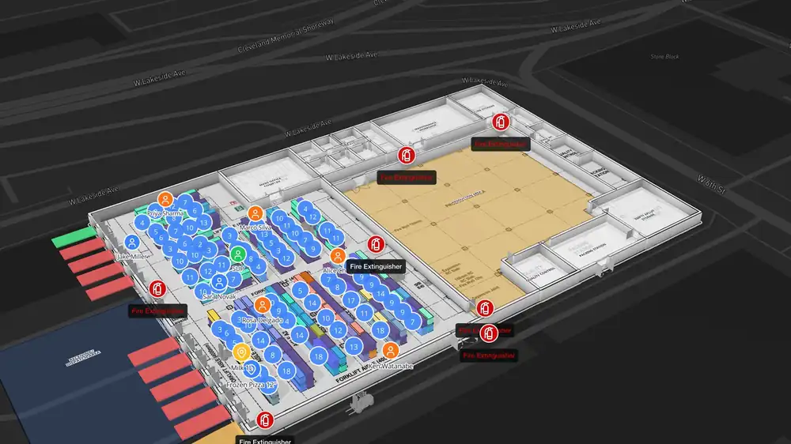
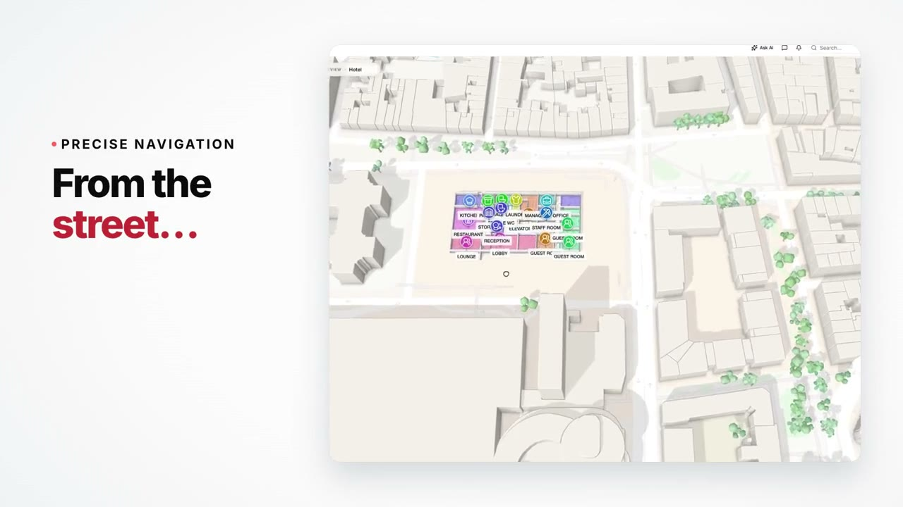
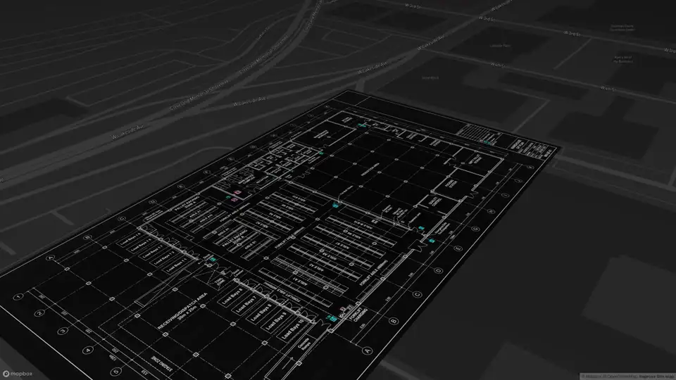
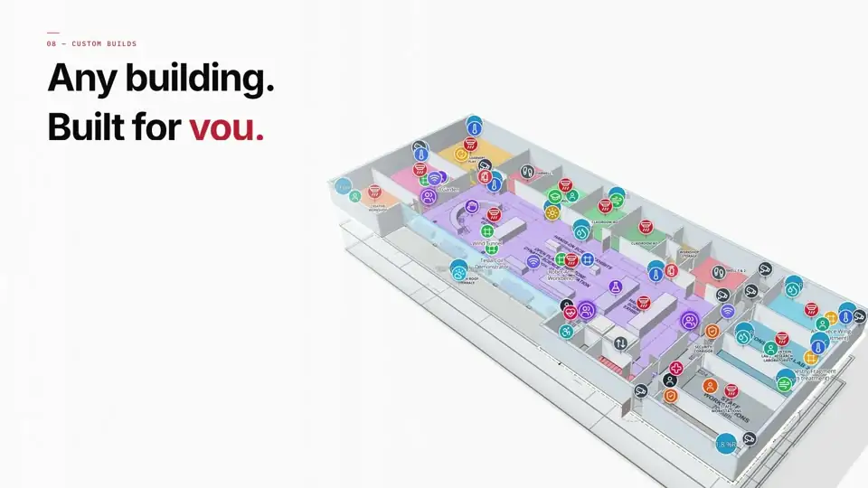

<div align="center">


# Spatial Map — logiciel open source de cartographie intérieure

[English](../../README.md) · [Español](README.es.md) · **Français** · [Deutsch](README.de.md) · [中文](README.zh-CN.md) · [العربية](README.ar.md)

**Transformez vos plans CAO, DWG et PDF en cartes intérieures 3D en direct et en jumeaux numériques.**
Cartographiez entrepôts, hôpitaux, centres commerciaux, usines et campus étage
par étage, connectez les données en direct de vos systèmes RTLS, RFID, BLE et
capteurs IoT, de votre WMS ou ERP, ou de n’importe quelle table, webhook ou API,
et suivez-les sur la carte avec cartes de chaleur, alertes, navigation pas à pas,
tableaux de bord et rapports. Auto-hébergé avec Docker. MIT.

[](https://github.com/Siraj-zaki/spatial-map/actions/workflows/ci.yml)
[](https://github.com/Siraj-zaki/spatial-map/releases)
[](../../LICENSE)

[**Documentation**](https://spatialmap.io/docs) ·
[**Version cloud**](https://spatialmap.io) ·
[Démarrage rapide](#démarrage-rapide) ·
[Versions](https://github.com/Siraj-zaki/spatial-map/releases)



<a href="../media/spatial-map-tour.mp4"></a>


▶ [**Voir la visite de 50 secondes**](../media/spatial-map-tour.mp4) · d’un plan CAO à la carte d’entrepôt en direct

</div>

---

## Fonctionnalités

### Du plan à la carte intérieure en direct

| | |
|---|---|
|  | **Importez n’importe quel plan** : PDF, DWG (AutoCAD) ou image, placé sur une vraie carte et mis à l’échelle par **calibrage** (mesure d’une longueur connue). Dessinez des murs qui **se raccordent proprement aux angles**, des murs inclinés, des zones, portes, escaliers, ascenseurs et escalators, des **rayonnages avec emplacements** (droits ou **le long d’un tracé**), des repères, étiquettes et modèles 3D. L’outil **Mesurer** (`U`), les cotes en direct et les **longueurs saisies** (`3.5`, `350cm`, `12'6`) offrent la précision d’un logiciel de CAO. |
|  | **Bâtiments multi-étages en 3D** : chaque étage à sa hauteur réelle, vues de référence par étage, feuille vierge pour les étages sans plan, modification en masse, annuler/rétablir, raccourcis clavier et **export** GeoJSON, CSV, XLSX et **3D `.glb`**. |
|  | **Visionneuse 3D en direct et jumeau numérique** : chaque étage, rayonnage, emplacement, zone et modèle 3D sur une vraie carte, avec des données en direct colorées selon vos règles. Le **mode focus** n’estompe que ce qui masque l’élément choisi. Partagez des liens en lecture seule. |

### Données en direct : RTLS, RFID, BLE, IoT, WMS et ERP

| | |
|---|---|
|  | **Liens de données** : reliez les lignes de tables, d’API REST, de webhooks, de fichiers ou de flux WebSocket aux formes par nom, code ou coordonnées. Positions RTLS, lectures RFID, balises BLE, valeurs de capteurs et enregistrements WMS / ERP arrivent de la même façon. La **relecture de l’historique** rejoue n’importe quel moment. |
|  | **Alertes** (nouveau en 0.3.0) : règles sur n’importe quelle table (condition, durée, valeur périmée ou comptage), évaluées par le serveur toutes les 15 s, localisées sur la carte, avec cloche et signal sonore. |
|  | **Rapports et tableaux de bord** : KPI, graphiques, tableaux et filtres, un **rapport maître** par site, des rapports prêts pour chaque site et table, des **cartes de chaleur** qui s’arrêtent aux murs, le **regroupement de points** et des **liens publics vers un rapport**. |

### Navigation

| | |
|---|---|
|  | **Navigation intérieure pas à pas** : itinéraires alignés sur les axes du bâtiment, passant par le centre des portes et **changeant d’étage** par escaliers et ascenseurs. La **recherche de lieux** trouve adresses, coordonnées et liens Google Maps / OpenStreetMap. |

### Et aussi

- **Espaces de travail, membres et rôles personnalisés** ; les administrateurs peuvent créer des comptes ; les lecteurs restent en lecture seule, y compris via l’API.
- **Tables** avec import CSV/XLSX, API REST et jetons par table, interrogation de sources et historique des lignes.
- **Solutions** pour regrouper sites, rapports et données.
- **Six langues** (anglais, espagnol, français, allemand, chinois, arabe avec RTL), thèmes clair/sombre et 46 palettes.
- **Auto-hébergé = tout est débloqué** : pas d’offres, pas de limites, pas de télémétrie.

> **Vous préférez ne pas l’héberger ?** [spatialmap.io](https://spatialmap.io) est la version cloud gérée.

---

## Cas d’usage

| | |
|---|---|
| **Entrepôts et logistique (WMS)** | Rayonnages et emplacements selon le stock, chemins de préparation, quais, chariots et préparateurs sur la carte |
| **Hôpitaux (RTLS)** | Localisation du personnel, des patients et des équipements, occupation des salles, alertes chaîne du froid |
| **Commerce, centres commerciaux, supermarchés** | Plans de magasin, cartes de chaleur de fréquentation, alertes antivol, orientation en magasin |
| **Usines (IoT)** | Machines et capteurs sur le plan, état en direct, alertes maintenance et sécurité |
| **Bureaux, campus, lieux d’événements, musées** | Salles, postes et actifs, orientation des visiteurs |

---

## Démarrage rapide

**Il vous faut** [Docker](https://docs.docker.com/get-docker/) (Compose v2.20+) et un [jeton d’accès Mapbox](https://account.mapbox.com/access-tokens/) gratuit.

```bash
git clone https://github.com/Siraj-zaki/spatial-map.git
cd spatial-map
cp .env.example .env          # définissez VITE_MAPBOX_ACCESS_TOKEN=pk....
docker compose up -d          # le premier lancement construit les images (quelques minutes)
```

Ouvrez **http://localhost:3000** et **inscrivez-vous**. Sans SMTP, le code de vérification s’affiche dans le journal de l’API :

```bash
docker compose logs api | grep -i "verification code"
```

Une nouvelle installation inclut un **espace de travail de démonstration** avec cinq sites d’exemple et 84 rapports. Désactivez-le avec `SPATIAL_MAP_DEMO=false` **avant le premier démarrage**.

### Envoyez vos données

Chaque table a sa propre API REST et ses jetons. Envoyez une ligne depuis un serveur RTLS, une passerelle IoT, votre WMS ou ERP, ou un script :

```bash
curl -X POST http://localhost:3000/api/v1/public/tables/rows \
  -H "Authorization: Bearer $SPATIAL_MAP_TABLE_TOKEN" \
  -H "Content-Type: application/json" \
  -d '{"entityKey": "cam-07", "payload": {"name": "Camera 7", "status": "online"}, "position": [-81.7006, 41.5004]}'
```

Reliez la table à un site dans l’éditeur (**Liens de données**) : la ligne apparaît sur la carte dès qu’elle change.

---

## Configuration, développement et documentation

- Toutes les options de `docker compose` sont dans [.env.example](../../.env.example) ; le tableau complet est dans le [README anglais](../../README.md#configuration).
- Guide utilisateur : **[spatialmap.io/docs](https://spatialmap.io/docs)**.
- Documentation technique : [ARCHITECTURE.md](../../ARCHITECTURE.md), [docs/](../), [AGENTS.md](../../AGENTS.md), [SECURITY.md](../../SECURITY.md).
- Stack : React 19 · TypeScript · Vite · Mapbox GL 3 · Go 1.25 · PostgreSQL/PostGIS · MinIO · Redis.

## Contribuer et licence

Issues et pull requests bienvenues : lisez [CONTRIBUTING.md](../../CONTRIBUTING.md). Si Spatial Map vous est utile, une ⭐ aide d’autres personnes à le trouver.

[MIT](../../LICENSE) © contributeurs de Spatial Map. Les modèles 3D fournis sont sous CC BY 4.0 ([CREDITS.md](../../CREDITS.md)). Données cartographiques © Mapbox et © contributeurs OpenStreetMap.
