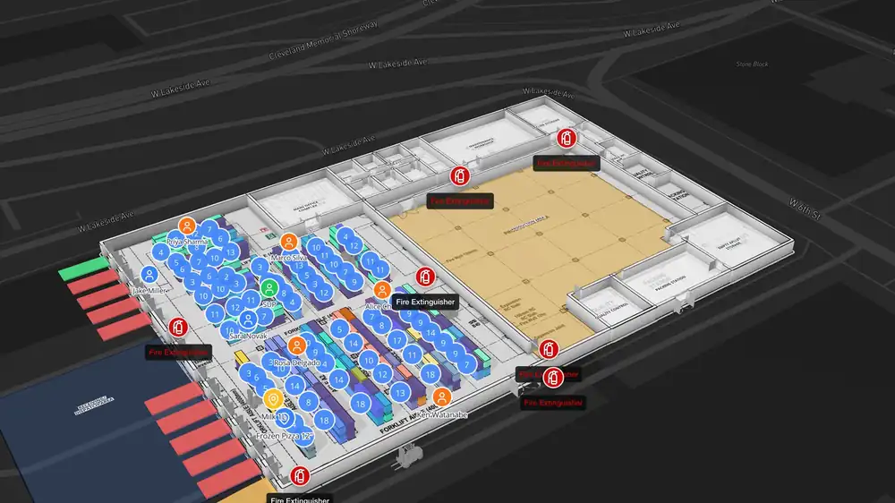
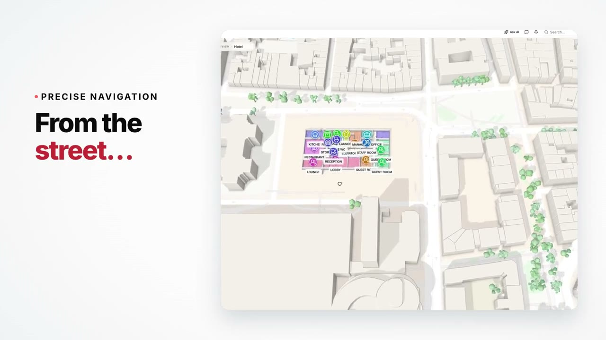
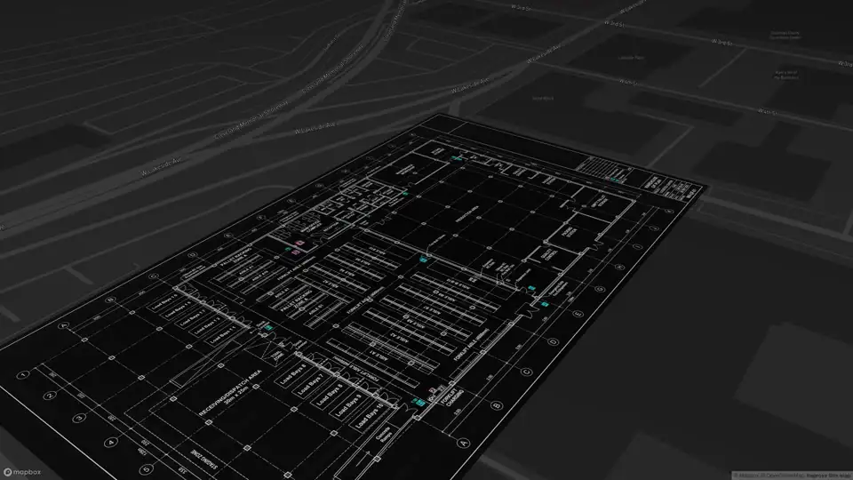
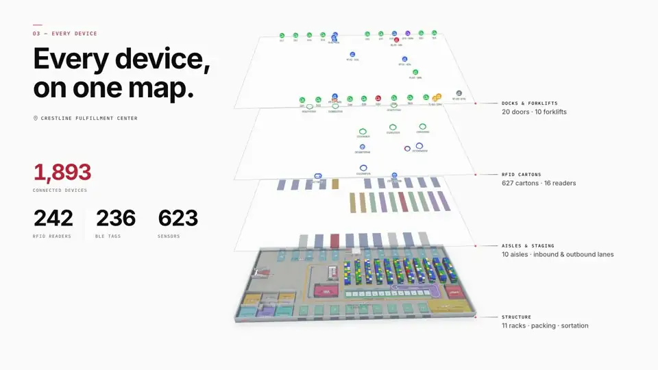

<div align="center">


# Spatial Map — 开源室内地图软件

[English](../../README.md) · [Español](README.es.md) · [Français](README.fr.md) · [Deutsch](README.de.md) · **中文** · [العربية](README.ar.md)

**把 CAD、DWG 和 PDF 平面图变成实时 3D 室内地图和数字孪生。**
逐层绘制仓库、医院、商场、工厂和园区，接入来自 RTLS、RFID、BLE 和 IoT 传感器、
WMS 或 ERP，以及任意数据表、Webhook 或 API 的实时数据，并在地图上通过热力图、
告警、室内导航、仪表盘和报表查看。使用 Docker 自托管，MIT 许可证。

[](https://github.com/Siraj-zaki/spatial-map/actions/workflows/ci.yml)
[](https://github.com/Siraj-zaki/spatial-map/releases)
[](../../LICENSE)

[**文档**](https://spatialmap.io/docs) ·
[**云端版本**](https://spatialmap.io) ·
[快速开始](#快速开始) ·
[版本发布](https://github.com/Siraj-zaki/spatial-map/releases)



<a href="../media/spatial-map-tour.mp4"></a>


▶ [**观看 50 秒产品导览**](../media/spatial-map-tour.mp4) · 从 CAD 图纸到实时仓库地图

</div>

---

## 功能

### 从平面图到实时室内地图

| | |
|---|---|
|  | **导入任意平面图**：PDF、DWG（AutoCAD）或图片，放置在真实地图上，并用**校准**工具按已知长度缩放。绘制在拐角处**自动对接**的墙体、倾斜墙、区域、门、楼梯、电梯和扶梯、**带货位的货架**（直线或**沿路径弯曲**）、标记、文字和 3D 模型。**测量**工具（`U`）、实时尺寸和**输入长度**（`3.5`、`350cm`、`12'6`）带来 CAD 级精度。 |
|  | **3D 多层建筑**：每层按真实高度叠放，支持分层参考视图、无图纸楼层的空白底图、批量编辑、撤销/重做、快捷键，以及导出为 GeoJSON、CSV、XLSX 和 **3D `.glb`**。 |
|  | **实时 3D 查看器与数字孪生**：每层、货架、货位、区域和 3D 模型都显示在真实地图上，实时数据按你的规则着色。**聚焦模式**只淡化挡住所选对象的部分。可分享只读链接。 |

### 实时数据：RTLS、RFID、BLE、IoT、WMS 和 ERP

| | |
|---|---|
|  | **数据链接**：按名称、编码或坐标，把数据表、REST API、Webhook、文件或 WebSocket 数据流中的记录绑定到形状上。RTLS 位置、RFID 读数、BLE 标签、传感器数值以及 WMS / ERP 记录都以同样的方式接入。带时间范围的**历史回放**可重现任意时刻。 |
|  | **告警**（0.3.0 新增）：针对任意数据表的规则（条件、持续时间、数据过期或计数），服务器每 15 秒评估一次，在地图上定位，并有铃铛和提示音。 |
|  | **报表与仪表盘**：KPI、图表、表格和筛选器，每个设施一份**主报表**，为每个设施和数据表准备的现成报表，在墙体处截止的**热力图**、**点聚合**，以及**单个报表的公开链接**。 |

### 室内导航

| | |
|---|---|
|  | **逐步室内导航**：路线沿建筑轴线、穿过门的中心，并通过楼梯和电梯**跨楼层**。**地点搜索**可查找地址、坐标以及 Google 地图 / OpenStreetMap 链接。 |

### 更多

- **工作区、成员和自定义角色**；管理员可直接创建账号；查看者在 API 上同样只读。
- **数据表**：CSV/XLSX 导入，每张表独立的 REST API 和令牌，轮询数据源和行历史。
- **解决方案**：把设施、报表和数据分组。
- **六种语言**（英语、西班牙语、法语、德语、中文、阿拉伯语含 RTL），浅色/深色主题和 46 套配色。
- **自托管即全部解锁**：无套餐、无限制、无遥测。

> **不想自己部署？** [spatialmap.io](https://spatialmap.io) 是托管的云端版本。

---

## 应用场景

| | |
|---|---|
| **仓储与物流（WMS）** | 按库存着色的货架和货位、拣货路径、装卸口、叉车和拣货员位置 |
| **医院与医疗（RTLS）** | 人员、患者和设备定位，房间占用，冷链告警 |
| **零售、商场与超市** | 门店布局、客流热力图、防盗告警、店内导航 |
| **制造与工厂（IoT）** | 平面图上的设备与传感器、实时状态、维护与安全告警 |
| **办公、园区、场馆与博物馆** | 房间、工位和资产，访客导航 |

---

## 快速开始

**你需要** [Docker](https://docs.docker.com/get-docker/)（Compose v2.20+）和一个免费的 [Mapbox 访问令牌](https://account.mapbox.com/access-tokens/)。

```bash
git clone https://github.com/Siraj-zaki/spatial-map.git
cd spatial-map
cp .env.example .env          # 设置 VITE_MAPBOX_ACCESS_TOKEN=pk....
docker compose up -d          # 首次运行会构建镜像（需要几分钟）
```

打开 **http://localhost:3000** 并**注册**。未配置 SMTP 时，验证码会打印在 API 日志中：

```bash
docker compose logs api | grep -i "verification code"
```

全新安装自带一个**演示工作区**，包含五个示例设施和 84 份报表。若想从空白开始，请在**首次启动前**设置 `SPATIAL_MAP_DEMO=false`。

### 推送你的数据

每张数据表都有自己的 REST API 和令牌。可以从 RTLS 服务器、IoT 网关、WMS / ERP 或脚本推送一行数据：

```bash
curl -X POST http://localhost:3000/api/v1/public/tables/rows \
  -H "Authorization: Bearer $SPATIAL_MAP_TABLE_TOKEN" \
  -H "Content-Type: application/json" \
  -d '{"entityKey": "cam-07", "payload": {"name": "Camera 7", "status": "online"}, "position": [-81.7006, 41.5004]}'
```

在编辑器中把数据表链接到设施（**数据链接**），数据一变化就会显示在地图上。

---

## 配置、开发与文档

- `docker compose` 的所有选项都在 [.env.example](../../.env.example) 中；完整配置表见[英文 README](../../README.md#configuration)。
- 用户指南：**[spatialmap.io/docs](https://spatialmap.io/docs)**。
- 技术文档：[ARCHITECTURE.md](../../ARCHITECTURE.md)、[docs/](../)、[AGENTS.md](../../AGENTS.md)、[SECURITY.md](../../SECURITY.md)。
- 技术栈：React 19 · TypeScript · Vite · Mapbox GL 3 · Go 1.25 · PostgreSQL/PostGIS · MinIO · Redis。

## 参与贡献与许可证

欢迎提交 Issue 和 Pull Request，请先阅读 [CONTRIBUTING.md](../../CONTRIBUTING.md)。如果 Spatial Map 对你有帮助，点一个 ⭐ 能让更多人发现它。

[MIT](../../LICENSE) © Spatial Map 贡献者。随附的 3D 模型采用 CC BY 4.0 许可（[CREDITS.md](../../CREDITS.md)）。地图数据 © Mapbox 和 © OpenStreetMap 贡献者。
